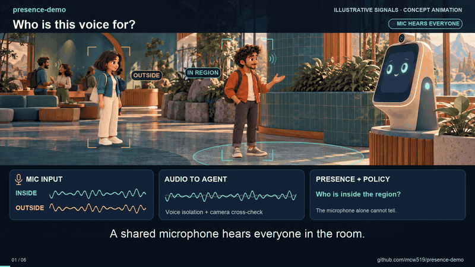
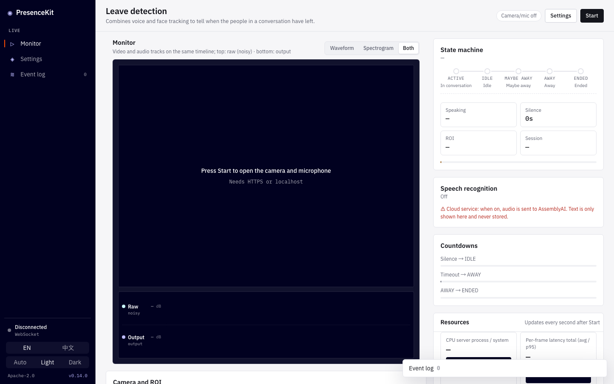
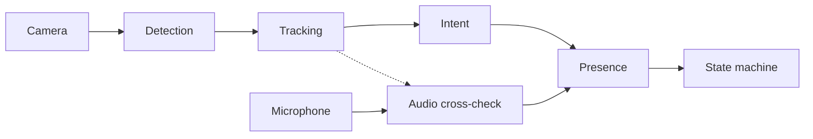

**English** · [繁體中文](README.zh-TW.md)

# presence-demo

**Know when the person you are talking to has left.**

presence-demo combines a camera and a microphone to tell a conversational device (a robot, a kiosk, a smart
speaker with a camera) whether the person, or the group, it is talking to is still there. It is a small,
explainable pipeline (face and body detection, tracking, an engagement score, a probabilistic presence model and
a five-state machine) plus a web demo that shows every step live.

## Watch the concept film

[](docs/media/presence-demo-intro-en.mp4)

[Watch the full film with sound — 49 seconds](docs/media/presence-demo-intro-en.mp4) · [English subtitles](docs/media/presence-demo-intro-en.srt)

An animated introduction to quiet presence, group continuity, and how distance informs audio decisions.
The waveforms illustrate the intended behavior; they are not recorded benchmark results.

### Live web demo



## Why

"No speech for 20 seconds" is a poor way to end a conversation. People pause, look at their phone, or listen
quietly while a friend talks, and a TV in the background never stops talking. presence-demo looks at **who is
actually there and engaged**, uses audio only where it helps, and writes down the reason for every decision.

## Features

- **Five clear states**: `ACTIVE → IDLE → MAYBE_AWAY → AWAY → ENDED`, with hysteresis and a written reason for
  every transition, plus **NEW_GROUP** when the next visitor steps up without the room ever being empty.
- **Groups, not just faces**: every person is tracked; the session lasts while any participant is still there.
- **Robust tracking**: greedy matching or a Kalman filter with Hungarian assignment, clothing colour and coasting
  through short occlusions.
- **Engagement intent**: passers-by and bystanders do not start conversations or keep them alive.
- **Probabilistic presence**: a per-person probability that shrugs off flickering detections.
- **Audio that knows where the voice comes from (optional)**: PureSound voice isolation, cross-checked against
  vision so a TV or a distant voice does not count as the user.
- **Pose and distance (optional)**: MoveNet skeletons, orientation, and a calibrated distance estimate.
- **Light enough for small devices**: motion gate, embedding throttling, adaptive fps and ROI cropping cut CPU by
  about 70%; TFLite / NPU embedding backend.
- **Embeddable SDK on ONNX Runtime**: `presence_demo.sdk.PresenceEngine` (frames and VAD or audio in, state and
  events out) with no web framework; every model runs on ONNX Runtime with selectable execution providers
  (CPU, CUDA, DirectML, CoreML, QNN, OpenVINO…).
- **Private by default**: frames are processed in memory and never stored; face fingerprints are erased when a
  session ends. Cloud speech recognition and cross-session re-ID are optional and off by default.
- **Bilingual web UI**: English and Traditional Chinese, with live settings, presets, charts and an event log.

## Quick start

Requires [uv](https://docs.astral.sh/uv/) and Python ≥ 3.10.

```bash
git clone https://github.com/mcw519/presence-demo.git
cd presence-demo
uv sync
uv run presence-demo            # open http://127.0.0.1:8000 and press Start
```

Browsers only allow the camera on `localhost` or HTTPS. Before exposing the server to others, set
`PRESENCE_TOKEN` (see [Getting started](docs/getting-started.md)). In Settings, try the **Recommended** preset to
switch on the newer algorithms.

Optional voice isolation:

```bash
uv sync --extra puresound
uv run python scripts/fetch_puresound_model.py --clone
```

Use it from your own code (no web server; `pip install presence-demo` is enough):

```python
from presence_demo.sdk import PresenceEngine

engine = PresenceEngine()
step = engine.process_frame(bgr_frame, speaking=vad_flag)
print(step.snapshot["state"], [e.reason for e in step.events])
```

## How it works



Each stage has its own page with intuition, formulas, figures and evaluation results. Start with
[How it works](docs/how-it-works.md), then dive into [detection](docs/detection.md), [tracking](docs/tracking.md),
[intent](docs/intent.md), [presence](docs/presence.md), the [state machine](docs/state-machine.md) and
[audio](docs/audio.md).


## Documentation

The full index is in [docs/](docs/README.md). Highlights:

| | |
|---|---|
| [Getting started](docs/getting-started.md) | Install, run, expose safely, optional extras |
| [Configuration](docs/configuration.md) | Every parameter, presets, environment variables |
| [Tuning](docs/tuning.md) | Adapting to a new room or camera |
| [Performance](docs/performance.md) | CPU cost, latency, NPU backends |
| [Privacy](docs/privacy.md) | What is processed, kept and (optionally) sent out |
| [SDK and ONNX Runtime](docs/sdk.md) | Embedding `PresenceEngine`, execution providers, model files, porting |
| [Architecture](docs/architecture.md) | Code layout and WebSocket protocol |

## Project layout

```
presence_demo/     core logic, ONNX Runtime inference layer, SDK facade (sdk.py), FastAPI + WebSocket server
presence_demo/static/  web UI (HTML, JS, string tables, vendored PureSound CSS)
scripts/           benchmark, evaluation, model export, figure and doc generators
tests/             unit, scenario, WebSocket, privacy, UI and i18n tests
docs/              documentation (English) and docs/zh-TW/ (Traditional Chinese)
```

## Development

```bash
uv run ruff check . && uv run ruff format --check .
uv run pytest -q
```

Contributions are welcome. Please read [CONTRIBUTING.md](CONTRIBUTING.md) and the
[Code of Conduct](CODE_OF_CONDUCT.md). Report security issues as described in [SECURITY.md](SECURITY.md).
Changes are listed in [CHANGELOG.md](CHANGELOG.md).

## License

[Apache License 2.0](LICENSE); see also [NOTICE](NOTICE). Model weights and third-party packages keep their own
licenses. In particular, **the SFace face-embedding weights may carry non-commercial training-data
restrictions**; read [docs/licenses.md](docs/licenses.md) before commercial use, or disable SFace with
`PRESENCE_FACE_EMBEDDER=hist`.
