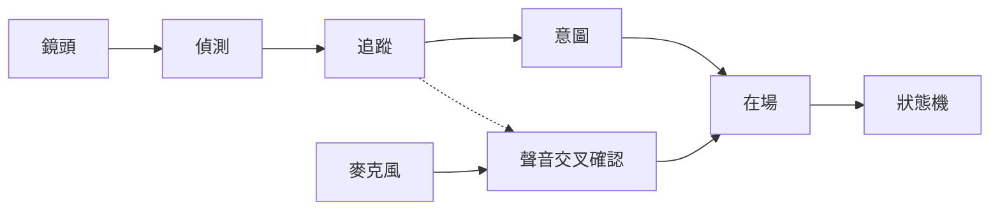

[English](README.md) · **繁體中文**

# PresenceKit

**知道正在跟你說話的人什麼時候離開了。**

PresenceKit 結合鏡頭和麥克風，讓對話裝置（機器人、服務機台、有鏡頭的智慧音箱）知道正在對話的人（或這群人）還在不在。
它是一條小而可解釋的管線（人臉與身體偵測、追蹤、互動意圖分數、機率式在場模型、五個狀態的狀態機），
加上一個即時顯示每一步的網頁 demo。

## 專案介紹影片

[](docs/media/presence-demo-intro-en.mp4)

[觀看有聲完整版 — 49 秒](docs/media/presence-demo-intro-en.mp4) · [英文字幕](docs/media/presence-demo-intro-en.srt)

透過動畫說明安靜但仍在場、多人對話的延續，以及距離如何參與收音判斷。影片為英文旁白與英文字幕；
波形呈現預期行為，並非實際錄製的效能測試結果。

### 即時網頁 demo


## 為什麼

「20 秒沒說話」不是結束對話的好方法。人會停頓、看手機，或安靜聽朋友說話；背景的電視卻從不停止說話。
PresenceKit 看的是**誰真的在、誰真的在互動**，只在有幫助時才用聲音，並且寫下每個決定的原因。

## 功能

- **五個清楚的狀態**：`ACTIVE → IDLE → MAYBE_AWAY → AWAY → ENDED`，有遲滯，每次轉換都寫出原因；
  下一位訪客在房間沒空過的情況下走上前時，觸發 **NEW_GROUP**。
- **看一群人，不只看臉**：每個人都被追蹤，只要還有一位參與者在，session 就繼續。
- **穩定的追蹤**：貪婪配對，或 Kalman 濾波加匈牙利演算法、衣服顏色，短暫遮擋時沿預測延續。
- **互動意圖**：路人和旁觀者不會開啟對話，也不會讓對話一直不結束。
- **機率式在場判斷**：每個人一個在場機率，不怕偵測閃爍。
- **知道聲音從哪裡來的音訊（選用）**：PureSound 人聲分離，再用影像交叉確認，電視或遠處的人聲不會被當成使用者。
- **姿勢與距離（選用）**：MoveNet 骨架、朝向和可校正的距離估計。
- **小裝置也跑得動**：移動閘門、embedding 節流、自適應 fps、ROI 裁切，CPU 約省 70%；支援 TFLite / NPU embedding 後端。
- **跑在 ONNX Runtime 上的可嵌入 SDK**：`presencekit.sdk.PresenceEngine`（畫面與 VAD 或音訊進，狀態與事件出），不需要
  網頁框架；所有模型都跑在 ONNX Runtime，可選擇執行提供者（CPU、CUDA、DirectML、CoreML、QNN、OpenVINO…）。
- **預設保護隱私**：畫面只在記憶體中處理，從不保存；臉部特徵在 session 結束時清除。雲端語音辨識和跨 session
  使用者判斷都是選用，預設關閉。
- **雙語網頁介面**：英文和繁體中文，可即時調整設定、預設組合、圖表和事件紀錄。

## 快速開始

需要 [uv](https://docs.astral.sh/uv/) 和 Python ≥ 3.10。

```bash
git clone https://github.com/mcw519/presence-demo.git
cd presence-demo
uv sync
uv run presencekit            # 開啟 http://127.0.0.1:8000，按「開始」
```

瀏覽器只在 `localhost` 或 HTTPS 下允許使用鏡頭。開放給其他人使用前，請先設定 `PRESENCE_TOKEN`
（見[快速開始](docs/zh-TW/getting-started.md)）。可以在設定中試試「**推薦**」預設組合，開啟較新的演算法。

選用的人聲分離：

```bash
uv sync --extra puresound
uv run python scripts/fetch_puresound_model.py --clone
```

在自己的程式裡使用（不需要網頁伺服器；`pip install presencekit` 就夠了）：

```python
from presencekit.sdk import PresenceEngine

engine = PresenceEngine()
step = engine.process_frame(bgr_frame, speaking=vad_flag)
print(step.snapshot["state"], [e.reason for e in step.events])
```

## 運作原理



每個階段都有一頁說明，包含直覺、公式、圖和評估結果。請從[運作原理](docs/zh-TW/how-it-works.md)開始，再看
[偵測](docs/zh-TW/detection.md)、[追蹤](docs/zh-TW/tracking.md)、[互動意圖](docs/zh-TW/intent.md)、
[在場判斷](docs/zh-TW/presence.md)、[狀態機](docs/zh-TW/state-machine.md)和[音訊](docs/zh-TW/audio.md)。


## 文件

完整目錄在 [docs/zh-TW/](docs/zh-TW/README.md)。重點：

| | |
|---|---|
| [快速開始](docs/zh-TW/getting-started.md) | 安裝、執行、安全開放、選用功能 |
| [設定參數](docs/zh-TW/configuration.md) | 所有參數、預設組合、環境變數 |
| [調參指南](docs/zh-TW/tuning.md) | 適應新的房間或鏡頭 |
| [效能](docs/zh-TW/performance.md) | CPU 成本、延遲、NPU 後端 |
| [隱私](docs/zh-TW/privacy.md) | 處理什麼、保存什麼、（選用時）送出什麼 |
| [SDK 與 ONNX Runtime](docs/zh-TW/sdk.md) | 嵌入 `PresenceEngine`、執行提供者、模型檔、移植 |
| [架構](docs/zh-TW/architecture.md) | 程式結構和 WebSocket 協定 |

## 專案結構

```
presencekit/         核心邏輯、ONNX Runtime 推論層、SDK 介面（sdk.py）、FastAPI + WebSocket 伺服器
presencekit/static/  網頁介面（HTML、JS、字串表、vendored PureSound CSS）
scripts/               基準測試、評估、模型匯出、圖片與文件產生器
tests/                 單元、情境、WebSocket、隱私、介面和 i18n 測試
docs/                  文件（英文），docs/zh-TW/（繁體中文）
```

## 開發

```bash
uv run ruff check . && uv run ruff format --check .
uv run pytest -q
```

歡迎貢獻。請先閱讀 [CONTRIBUTING.zh-TW.md](CONTRIBUTING.zh-TW.md) 和[行為準則](CODE_OF_CONDUCT.md)。
安全問題請依 [SECURITY.md](SECURITY.md) 回報。版本變更見 [CHANGELOG.md](CHANGELOG.md)。

## 授權

[Apache License 2.0](LICENSE)，另見 [NOTICE](NOTICE)。模型權重和第三方套件各自有授權。特別注意：**SFace 人臉 embedding
權重可能有非商業的訓練資料限制**，商用前請閱讀 [docs/zh-TW/licenses.md](docs/zh-TW/licenses.md)，或用
`PRESENCE_FACE_EMBEDDER=hist` 停用 SFace。
