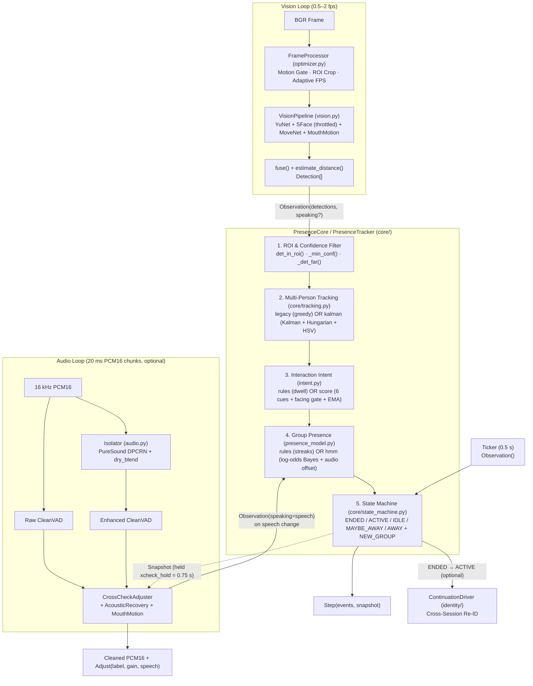
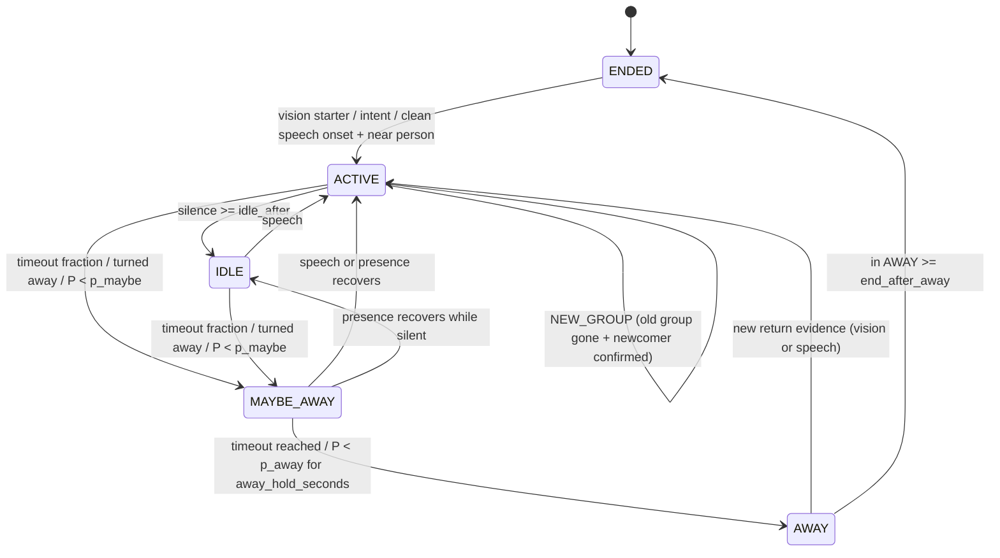

**English** · [繁體中文](zh-TW/algorithms.md)

# Algorithm Design & Assembly

This document is the technical entry point for PresenceKit's algorithms. It defines the data structures,
mathematical models, and decision rules of each layer in the latest codebase, and explains **how the layers
assemble** into the final presence state, events, and cleaned audio output.

For an intuitive walkthrough with a worked example, see [How it works](how-it-works.md). For deep dives and
evaluation figures on individual layers, see the per-layer pages linked in each section.

---

## 1. End-to-End Assembly Overview

PresenceKit runs two rate-decoupled processing streams plus a periodic timer tick, all converging on
`PresenceCore` (`presencekit/core/engine.py`) → `PresenceTracker` (`presencekit/core/tracker.py`):

### How the Caller Wires the Loops

- **Embedded SDK (`presencekit.sdk.PresenceEngine`)**:
  - `process_frame(image, speaking, now)` runs `FrameProcessor.process()` → `PresenceCore.update(Observation(dets, speaking), now)` → returns `Step`. When `process_audio()` is active (`audio_pipeline == "puresound"`), `speaking` passed to `process_frame` is ignored so the clean audio loop owns speech state.
  - `process_audio(pcm16, now)` runs `AudioStream.on_vision(snap, now)` → `AudioStream.process(...)` → if `speech != tracker.speaking`, calls `PresenceCore.update(Observation(speaking=speech), now)`.
  - `tick(now)` calls `PresenceCore.update(Observation(), now)` to advance silence and absence timers when no frames arrive.
- **Web Runtime (`presencekit.runtime.session.PresenceRuntime`)**:
  - Runs the same pipeline behind a latest-frame slot (drops superseded frames to avoid lag), a bounded audio queue (≤ 1 s), and a 0.5 s ticker, forwarding `Step.snapshot` and `Step.events` over WebSocket.

---

## 2. Core Data Contracts

Defined in `presencekit/core/tracks.py`, `presencekit/core/types.py`, `presencekit/body.py`, and `presencekit/audio.py`:

| Type | Key Fields | Role |
|---|---|---|
| `Body` | `bbox`, `conf`, `keypoints` | Normalized pose box and 17 MoveNet keypoints `(x, y, conf)` |
| `Detection` | `bbox`, `conf`, `embedding`, `face_bbox`, `body`, `frontal`, `appearance`, `mouth_motion` | Single-frame fused observation of one person (face, optional body, L2-normalized 128-d face vector, torso HSV histogram, lip optical-flow score) |
| `Track` | `id`, `bbox`, `embedding`, `conf`, `first_seen`, `last_seen`, `in_roi_since`, `participant`, `visible`, `visible_kind`, `vis_conf`, `logodds`, `intent`, `intent_cues`, `body`, `distance`, `facing`, `facing_score`, `trend`, `far`, `appearance`, `mouth_motion`, `kf` | Persistent per-person state across frames |
| `Observation` | `detections: list[Detection] \| None`, `speaking: bool \| None` | Input to `PresenceCore.update()` |
| `Step` | `events: tuple[PresenceEvent, ...]`, `snapshot: dict` | Output of every core update: newly emitted events + full state snapshot |
| `VisionView` | `usable`, `person`, `near`, `all_far`, `target`, `distance` | Vision summary held for `xcheck_hold` seconds for the audio cross-check |
| `Adjust` | `mix`, `gain`, `speech`, `label`, `target_track`, `distance` | Per-chunk audio cross-check decision (`agree`, `leak`, `false_accept`, `false_reject`, `silence`, `acoustic_only`) |

---

## 3. Layer-by-Layer Design

### Layer 1: Perception & Power Optimization (`optimizer.py`, `vision.py`, `body.py`, `mouth_motion.py`)

`FrameProcessor.process(image, cfg, stable, frame_time)` turns a raw BGR frame into `list[Detection]`:

1. **Motion Gate (`motion_gate`)**: Downscales the frame to a `64×48` grayscale thumbnail. If `stable` is `True` (state is not `MAYBE_AWAY` or `AWAY`), `mean(|thumb - prev_thumb|) / 255 < motion_threshold` (0.015), and `now - last_detect < force_detect_seconds` (2.0 s), detection is skipped and the previous detections are reused.
2. **ROI Crop & Downscale (`roi_crop`)**: Crops the union of active ROIs (`face_roi`, and `pose_roi` when `pose_enabled`) plus `crop_margin` (0.1), downscales so width ≤ `max_width` (640 px), runs detectors, and maps boxes and landmarks back to full-frame pixel/normalized coordinates (`map_raw_to_frame`).
3. **Face Detection & Throttled Embedding**:
   - **Detector**: `YuNet` on ONNX Runtime (`yunet_s_dynamic.onnx`), with OpenCV DNN or Haar fallbacks. Produces bounding box, confidence, and 5 landmarks (eyes, nose, mouth corners).
   - **Embedder**: `SFace` on ONNX Runtime (`fp32` or `int8`), LiteRT NPU delegate (`npu`), or HSV histogram fallback (`PRESENCE_FACE_EMBEDDER=hist`).
   - **Embedding Throttle (`embed_throttle`)**: Reuses a cached 128-d embedding if the face box matches an existing cache entry (`IoU` / `moved() <= embed_move_thresh` (0.15)), `self_sim` is high, and `now - cached.t < embed_interval` (3.0 s).
4. **Optional Pose, Orientation & Distance (`pose_enabled`, `distance_enabled`)**:
   - **Pose**: `MoveNet MultiPose Lightning` (ONNX Runtime or LiteRT fallback), throttled by `pose_interval` (2.0 s) when all tracked faces are stable.
   - **Face ↔ Body Fusion (`fuse()`)**: Greedy matching (`associate()`) pairs each face with a body whose head region contains the face center. Unpaired bodies become body-only detections using `head_box(body)`.
   - **Orientation (`orientation(body)`)**: Scores `0..1` from nose (0.35), eyes (0.25), mirror shoulder order `ls.x > rs.x` (0.20), and shoulder-to-torso width ratio (up to 0.20). Maps to `"facing"` (≥ 0.6), `"side"` (≥ 0.3), or `"away"` (< 0.3).
   - **Distance (`estimate_distance()`)**: Uses pinhole geometry `d = (real_width * f_px) / box_width_px * distance_calib`, where `f_px = 0.5 / tan(hfov / 2)` (normalized). Prefers face width when facing, shoulder width when available, smoothed with `distance_ema` (0.3). Tracks `trend` (`approaching` / `receding` / `steady`) over ~2 s using `recede_ratio` (0.1).
5. **Optional Mouth Motion (`mouth_motion.py`)**:
   - Active when `xcheck_recovery_mode == "audiovisual"`. Aligns consecutive frames (gap ≤ `FRESH_S = 0.085 s`) into `128×128` grayscale patches via eye landmarks, computes Farneback optical flow, subtracts median cheek motion (suppressing head jitter), and outputs the 3-frame median lip-to-cheek motion normalized by mouth width.

> Details: [Detection](detection.md) · [Performance](performance.md)

---

### Layer 2: Multi-Person Tracking (`core/tracking.py`, `kalman.py`, `appearance.py`)

Before matching, `PresenceTracker.update()` filters detections:

- **ROI Gate (`det_in_roi`)**: Depending on `roi_rule` (`either`, `face`, `body`), checks whether the face center is in `face_roi` and/or the body center is in `pose_roi`.
- **Confidence Split**: Detections with `conf >= _min_conf(d)` (`min_conf` = 0.4 for face detections, `body_min_conf` = 0.4 for body-only) enter tracking as `confident`. Lower-confidence detections form `low` (used only to signal vision uncertainty).
- **Far Check (`_det_far`)**: When `distance_enabled`, detections beyond `leave_distance` (2.5 m) cannot start a new session as `starters`.

Each frame sets all tracks to `visible=False, visible_kind="none", vis_conf=0.0`, then runs one of two matchers:

- **`legacy` (Greedy)**: Scores `(det, track)` pairs by `cos_sim + 0.5 * IoU` (using body IoU if either embedding is missing), gated by `cos_sim >= match_cos` OR (`IoU >= iou_match` AND `cos_sim >= cos_weak`), and assigns greedily in descending order.
- **`kalman` (Kalman + Hungarian + Appearance)**:
  1. Predicts each track's box to `now` using a constant-velocity 4D `KalmanBox` `(cx, cy, w, h, vx, vy, vw, vh)`.
  2. Builds a cost matrix `1 - score` where `score` is the weighted mean of available cues:
     - Box `IoU` against predicted box (weight 1.0)
     - Motion gate score `exp(-d² / gate_mahalanobis)` (weight 1.0)
     - Face cosine similarity normalized by `match_cos` (weight 2.0)
     - Torso HSV histogram Bhattacharyya similarity `appearance_similarity` (weight 1.5, when available)
  3. Rejects pairs failing the Mahalanobis gate (`d² > 9.21` without strong face or IoU), face mismatch (`cos_sim < cos_weak`), or clothing mismatch (`appearance_sim < appearance_min_sim` when face is absent), or total `score < 0.3`.
  4. Solves optimal assignment via the Hungarian algorithm (`hungarian(cost)`).
  5. **Coasting**: Unmatched tracks with a Kalman filter and `now - last_seen <= coast_seconds` (2.0 s) remain `visible=True, visible_kind="predicted"` with `vis_conf = max(0, 1 - (now - last_seen) / coast_seconds)` and predicted `bbox`.

Matched tracks update their face embedding via EMA (`embed_ema = 0.15`) and torso HSV histogram (`appearance_ema = 0.2`). Unmatched tracks exceeding `grace_seconds` (15 s) are dropped.

> Details: [Tracking](tracking.md)

---

### Layer 3: Interaction Intent (`intent.py`, `core/tracking.py`)

Intent separates **participants** (interacting with the device) from **bystanders** (passing by):

- **`rules` mode**: A visible, non-far track becomes `participant=True` once `now - in_roi_since >= join_seconds` (2.0 s), or immediately if `_speech_joinable()` holds (when `speaking` is `True` and `speech_join` allows it—by default `single_candidate` requires a single near, facing candidate with a face in `face_roi`).
- **`score` mode**: Computes a per-frame raw score from up to 7 normalized cues in `[0, 1]`:

| Cue | Formula / Source | Default Weight |
|---|---|---|
| `facing` | `frontal_from_landmarks()` (nose-to-eye offset) fused with MoveNet `facing_score` | `w_facing = 0.45` |
| `still` | `max(0, 1 - \|vx\| / 0.12)` | `w_still = 0.15` |
| `center` | `1 - hypot(dx, 0.5 * dy)` inside `face_roi` | `w_center = 0.15` |
| `distance` | `1.0` if `d <= zone_max`, linear decay to `0.0` at `leave_distance` | `w_distance = 0.10` |
| `dwell` | `min(1.0, (now - in_roi_since) / 4.0)` | `w_dwell = 0.10` |
| `approach` | `clip(0.5 + 4.0 * rel_size_rate, 0, 1)` | `w_approach = 0.05` |
| `speech` | `1.0` while `speaking` and attribution is plausible | `0.05 / 0.15 / 0.25` (by `priority_mode`) |

Missing cues (e.g. `distance` when disabled) are omitted and the remaining weights are renormalized (`raw_score()`). An **attention gate** prevents high scores when looking away:

$$\text{gated} = \text{raw} \times \bigl(1 - 0.5 \cdot (1 - \text{facing})\bigr)$$

The track's `intent` is smoothed over real time `dt` with time constant `intent_tau` (1.0 s):

$$\text{intent}_t = \text{intent}_{t-1} + (\text{gated} - \text{intent}_{t-1}) \cdot \left(1 - e^{-dt / \tau}\right)$$

A track joins as `participant=True` when `intent >= join_threshold` (0.6) for `join_seconds`, and drops back to bystander when `intent < drop_threshold` (0.35) for `drop_seconds` (8.0 s).

> Details: [Intent](intent.md)

---

### Layer 4: Group Presence (`presence_model.py`, `core/state_machine.py`)

Converts per-track visibility into a stable group presence signal (`present`, `empty`, and `p_group` in HMM mode):

- **`rules` mode**:
  - `confident` (at least one visible, non-far, detected track) increments `_present_streak`; after `present_frames` (2), `present = True, empty = False`.
  - `coasting` (a Kalman-predicted track with `vis_conf >= coast_present_conf`) holds off `_first_empty_at` and prevents `empty = True`.
  - `low` (only low-confidence detections) increments `_low_streak`; after `absent_frames` (3), sets `present = False, empty = False` (uncertain path → falls back to `base_timeout`).
  - Empty frames increment `_empty_streak`; after `absent_frames` (3) without coasting, `present = False, empty = True` and `empty_since` records the start of absence.
- **`hmm` mode (Continuous-Time Log-Odds Bayes Filter)**:
  - Each track maintains $L = \log\frac{P(\text{present})}{1 - P(\text{present})} \in [L_{\min}, L_{\max}]$ (clamped to $[0.02, 0.98]$ in probability) and updates over `dt = min(now - prev_t, 3.0)`:
    $$L \leftarrow \text{clip}\bigl(L + \text{rate} \cdot dt,\; L_{\min},\; L_{\max}\bigr)$$
  - `track_rate()` sets $\text{rate}$ from the track's frame status ($\lambda = \ln 2 / \text{leave\_halflife}$):
    - `far` (`> leave_distance`): $-3\lambda$
    - `detected` & `turned_away`: $-\lambda$
    - `detected` (normal): $+\text{detect\_gain} \cdot \text{conf}$
    - `predicted` (coasting): $-\lambda \cdot (1 - \text{vis\_conf})$
    - `low_frame`: $-\lambda \cdot \text{lowconf\_factor}$
    - `none` (unseen): $-\lambda$
  - **Group aggregation (`p_tracks`)**: Takes `max(t.p)` over `participants` (or over intent-passing candidates if no participant has joined yet; weighted by `intent / join_threshold` if `intent_weighted_presence` is enabled). If participants are below `p_away` while a stable new candidate is forming (`p >= p_active` for `join_seconds`), `p_tracks` includes the candidate to avoid flapping to `AWAY` before `NEW_GROUP`.
  - **Audio fusion (`p_group`)**: Global audio evidence $a$ (`audio_offset`) is added in log-odds space (never attributed to a single track):
    $$p_{\text{group}} = \sigma\bigl(\text{logit}(p_{\text{tracks}}) + a\bigr)$$
    where $a = +w_{\text{speech}} \cdot 5.0$ when speaking, and $-w_{\text{silence}} \cdot 6.0 \cdot \min(1, \text{silence} / \text{base\_timeout})$ when silent (`vision`: $w_{\text{speech}}=0.05, w_{\text{silence}}=0.0$; `balanced`: $0.8, 0.8$; `audio`: $1.0, 1.0$).

> Details: [Presence](presence.md)

---

### Layer 5: Session State Machine & Group Handoff (`core/state_machine.py`)

Five states form the session lifecycle:

Key assembly rules:

- **Entry Gating (`_entry_only`, `_onset_ok`)**: When `audio_pipeline == "puresound"` (`speech_source == "clean"`):
  - With `onset_entry_only = True` (the default), a session opens **only** on a clean-speech onset while a confident near person was seen within 1.5 s (`set_speech`). Vision alone or speech alone does not open a session.
  - With `onset_entry_only = False`, `onset_needs_vision` still prevents distant TV speech from opening a session without a recent near person (unless vision is uncertain).
- **Priority Modes (`priority_mode`)**:
  - `vision`: Presence alone keeps the session alive (`IDLE` forever unless `present_max_silence > 0`). Empty ROI times out after `empty_timeout` (5 s) even if audio is playing. Only vision can return from `AWAY` (unless `AWAY` was entered via `present_max_silence`, in which case `_capped_return()` requires speech, a newcomer, or an observed absence).
  - `balanced`: Uses `present_timeout` (15 s) when present, `empty_timeout` (5 s) when empty, `base_timeout` (20 s) when uncertain.
  - `audio`: Scales `base_timeout` by `1.5×` when present, `0.5×` when empty, `1.0×` when uncertain.
- **Early Turned-Away Cue (`turned_away_early`)**: If all visible, non-far participants are `side`/`away` and `receding` for `turned_away_seconds` (2.0 s) while silent, the session enters `MAYBE_AWAY` early.
- **Group Handoff (`NEW_GROUP`)**: While not `ENDED`, if `_old_group_missing()` is `True` and at least one non-participant, non-far, detected newcomer satisfies `join_seconds` (and `p >= p_active` in HMM, `_intent_ok` in score) for `new_group_seconds` (3.0 s), the old session ends and a new session starts immediately (`ENDED` is bypassed) with those newcomers promoted to `participant=True`.

> Details: [State machine](state-machine.md)

---

### Stage 6: Audio Isolation, Vision Cross-Check & Onset Recovery (`audio.py`, `acoustic_recovery.py`)

When `audio_pipeline == "puresound"`, every 20 ms 16 kHz PCM16 chunk runs through:

1. **Isolation (`Isolator`)**: Streams 10 ms hops (512-point STFT, 30 ms look-ahead) through `dpcrn_curriculum_v2.onnx`, blending `iso_dry_blend` (default 0.9, `Near-field priority` 1.0) of enhanced speech with delay-aligned raw input. Automatically resets (`iso_reset_on_change`) on `NEW_GROUP`, session change, or participant-set change.
2. **Dual `CleanVAD`**: Tracks adaptive noise floor (falls immediately, rises ~3 dB/s) on both the **enhanced** signal (`clean`) and **raw** input (`raw`). Speech requires `level > max(min_db, floor + margin_db)` for 60 ms (`min_on`), with `clean_vad_hang` (0.3 s) hangover.
3. **Vision Alignment (`CrossCheckAdjuster.view`)**: Computes freshness `age = max(vis_age, max(0, capture_gap))`. If `snap` is missing, `age > xcheck_stale` (2.0 s), or `path == "uncertain"`, vision is `usable=False`. Otherwise, `person`, `near` (within `near_range`), and `all_far` are each held for `xcheck_hold` (0.75 s), with `all_far` suppressed whenever `near` is held (protecting near-speaker onsets).
4. **Decision Table (`CrossCheckAdjuster.decide`)**:
   - `usable == False` or `xcheck_enabled == False` → `acoustic_only` (pass PureSound output, `speech = clean`).
   - `clean` and `not person` → `leak` (attenuate to `xcheck_floor_db` = −40 dB, `speech = False`).
   - `clean` and `all_far` → `false_accept` (attenuate to `xcheck_floor_db`, `speech = False`).
   - `clean` and `near` → `agree` (gain 1.0, `speech = True`).
   - `not clean` and `raw` and `near` → `false_reject`. Behavior depends on `xcheck_recovery_mode`:
     - `legacy`: mixes `xcheck_recover_mix` (0.3) enhanced + 0.7 delay-aligned raw, `speech = True`.
     - `audio`: uses `AcousticRecovery` (raw onset spectral rise ≥ 8 dB and high-to-low tilt ≤ −12 dB, held for `HOLD_S = 0.12 s`) to decide whether to recover the onset (`speech = True`) or keep it suppressed (`speech = False`).
     - `audiovisual`: recovers when either `AcousticRecovery` allows **or** a near visible track has fresh `mouth_motion >= MOUTH_THRESHOLD` (`~0.00459`).
   - Otherwise → `silence` (gain 1.0, `speech = False`).

Gain transitions ramp smoothly (`xcheck_attack = 0.01 s`, `xcheck_release = 0.05 s`).

> Details: [Audio](audio.md)

---

### Stage 7: Optional Cross-Session Re-ID (`identity/`)

Off by default (`reid_enabled = False`, requires `reid_consent = True` and `TYPESAFE_API_KEY`).

1. When a session ends normally (`ENDED`), up to `reid_max_refs` (3) ended conversations (up to 3 face crops each, kept in memory for `reid_ttl = 600 s`) are retained per page/stream.
2. When a new session opens (`ENDED → ACTIVE`), `ContinuationDriver` waits up to `reid_face_wait` (3.0 s) for a usable face crop (`width >= reid_min_face`), checks `CallGuard` (cooldown, hourly/total caps, circuit breaker), and queries `IdentityMatcher` (`Jev` client).
3. Similarity `>= reid_threshold` (0.9) resumes the matched `conversation_id`; `[reid_uncertain_low, reid_threshold)` retries once on a fresh frame; `< reid_uncertain_low` starts a new conversation.

> Details: [Re-ID](reid.md)

---

## 4. Preset Configurations (`settings.js`)

Presets configure multiple layers at once so they work together:

| Preset | Tracking | Intent | Presence | Audio | Pose & Distance | FPS |
|---|---|---|---|---|---|---|
| **Standard** | `legacy` | `rules` | `rules` | `energy_vad` | off | adaptive 0.5–2 |
| **Near-field priority** *(default for new browsers)* | `kalman` | `score` | `hmm` | `puresound` (`iso_dry_blend=1.0`, `iso_onset_guard=false`, `xcheck_recovery_mode="audio"`, `near_range=1.3`) | on | fixed 2 |
| **Low power** | `legacy` | `rules` | `rules` | `energy_vad` | off (`max_width=480`, `embed_interval=5.0`) | adaptive 0.5–1 |
