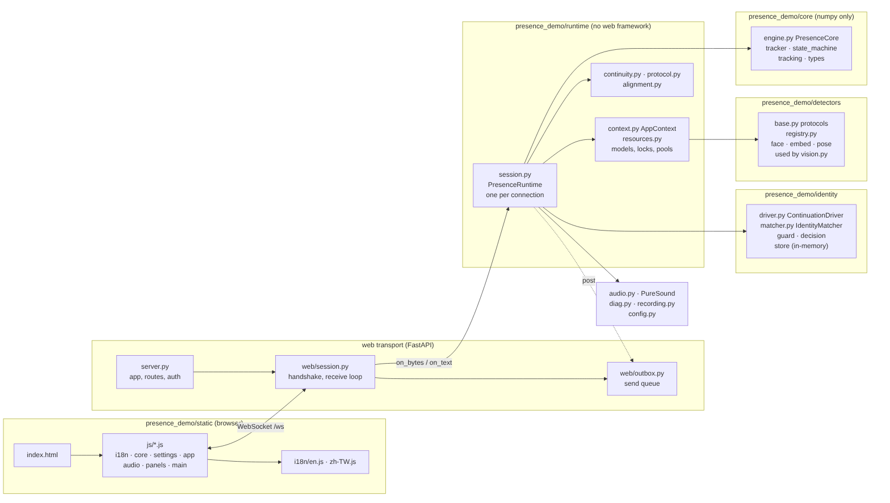
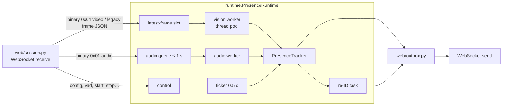

**English** · [繁體中文](zh-TW/architecture.md)

# Architecture

presence-demo is a Python package with a pure-logic core (no I/O, unit-testable with an injected clock) and a
FastAPI + WebSocket web demo around it. The browser captures camera and microphone and draws the UI; the server
does all the analysis in memory.



## Code layout

```
presence_demo/
  core/              pure logic (numpy only, no I/O): the presence engine
    types.py         typed values: Observation, VideoFrame, PresenceEvent, Step
    tracks.py        Detection, Track · geometry.py boxes/IoU · tracking.py association, Kalman, appearance
    state_machine.py presence/intent scoring and the session state machine
    tracker.py       PresenceTracker (v0.12 API) · engine.py PresenceCore (typed facade: Observation -> Step)
  detectors/         face detector / embedder / pose protocols, built-ins (YuNet, Haar, SFace, hist, MoveNet), registry
  identity/          cross-session re-ID: in-memory crops and store, matcher protocol + Jev client,
                     call guard (caps, breaker), decision, ContinuationDriver
  runtime/           framework-free per-connection runtime
    session.py       PresenceRuntime: tracker, vision/audio workers, ASR gate, watchdog, control messages
    context.py       AppContext: the process-wide dependencies passed to a runtime
    protocol.py      wire protocol (binary tags, video framing, CLIENT_MESSAGE_TYPES)
    resources.py     process-wide models, locks, worker pools · continuity.py page lease, observation clock
    alignment.py     audio/vision timing provenance
  config.py          Config dataclass (flat keys + grouped view), RANGES (validation), State enum
  tracker.py         v0.12 import path for core.tracker (re-exports)
  kalman.py          constant-velocity Kalman filter, Hungarian algorithm
  presence_model.py  HMM log-odds helpers (Layer 2)
  intent.py          intent cues and smoothing (Layer 3)
  appearance.py      torso HSV histogram, Bhattacharyya similarity
  body.py            pose orientation, face↔body association, distance and calibration
  vision.py          VisionPipeline (detect + embed), in-memory decode; re-exports the detectors
  embed_backends.py  SFace fp32 / int8 / TFLite (+ delegate) backends
  optimizer.py       motion gate, embedding throttle, ROI crop, adaptive fps
  audio.py           PureSound streaming glue, clean VAD, vision cross-check
  asr.py             AssemblyAI streaming client (optional)
  reid.py            v0.12 import path for identity (re-exports; CrossSessionReid = ContinuationDriver)
  acceptance.py      unified offline PoC acceptance runner and report schema
  acceptance_cases.py synthetic state-machine and mock re-ID scenarios
  acceptance_pipeline.py isolated local-model WebSocket replay and soak measurement
  acceptance_browser.py isolated headless-Chrome browser acceptance adapter
  acceptance_browser_reid.py isolated Chrome-to-server re-ID/handoff acceptance adapter
  diag.py            structured logging, redaction, event ring buffer, watchdog helpers
  stats.py           resource and latency statistics
  server.py          FastAPI app: routes, token middleware, static files, entry point
  web/               FastAPI transport only
    session.py       WebSocket handshake, receive loop and close; drives a runtime.PresenceRuntime
    outbox.py        per-connection send queue with back-pressure
    runtime.py, continuity.py, protocol.py, alignment.py   v0.12 import paths (re-exports from runtime/)
  static/
    index.html       markup only (text via data-i18n attributes)
    app.css          presence-specific layout on top of the vendored PureSound CSS
    js/              i18n · core · settings · app · audio · panels · main (classic scripts, load order matters)
    i18n/            en.js, zh-TW.js string tables
    vendor/puresound PureSound design system (unmodified)
scripts/             benchmark, evaluation, model export / fetch, figures, config docs
  run_acceptance.py  unified acceptance runner CLI
  acceptance_browser_fixture.js shared browser fixture for synthetic media and app-flow checks
  acceptance_browser_reid_fixture.js re-ID controls for isolated browser acceptance
tests/               unit, scenario, WebSocket, privacy, UI and i18n tests
```

## Layers (v0.13)

v0.13 separates the code into layers with a one-way dependency direction. Behaviour, wire protocol, settings and
defaults are unchanged; the old import paths keep working as re-exports.

```
web (FastAPI transport)  ->  runtime  ->  identity  ->  core
                                      ->  detectors ->  core
```

| Layer | Contains | May not import |
|---|---|---|
| `core` | tracking, presence/intent scoring, state machine, typed values, `PresenceCore` | anything but numpy and pure helpers (no OpenCV, no web, runtime, detectors, identity) |
| `detectors` | `FaceDetector`, `Embedder`, `PoseDetector` protocols, built-ins, `registry` | web framework, `web`, `runtime`, `identity`, `server` |
| `identity` | re-ID crops/store (memory only), `IdentityMatcher`, `CallGuard`, `decide`, `ContinuationDriver` | web framework, `web`, `runtime`, `server` |
| `runtime` | `PresenceRuntime`, `AppContext`, protocol, page continuity, process resources | `fastapi`, `starlette`, `uvicorn`, `web`, `server` |
| `web` + `server.py` | HTTP routes, token middleware, WebSocket handshake, outbox | — |

`tests/test_layering.py` enforces the table statically (AST imports) and checks that importing `core`,
`detectors`, `identity` and `runtime` never loads the web framework.

- **`PresenceCore`** (`core.engine`) is a typed facade over `PresenceTracker`: `update(Observation) -> Step`
  (events + the same snapshot dict). It produces exactly the tracker's steps (`tests/test_core.py`).
- **`PresenceRuntime`** owns everything one connection does. It talks to an *outbox* object
  (`post`, `run`, `backlog`, counters) and receives decoded packets through `on_bytes` / `on_text`, so it can be
  driven without FastAPI (`tests/test_runtime.py`).
- **`AppContext`** lists the process-wide dependencies a runtime receives (page registry, vision lock, audio pool,
  pipeline and pose loaders, vision job, calibration, audio stream factory). In v0.13 it only *references* the
  existing module singletons; ownership did not move. `web.session` builds it from its own module globals at
  connect time.
- **Settings.** `Config` keeps its flat keys (the only form on the wire and in presets). `Config.group(name)` and
  `Config.as_groups()` give a grouped read view (see [Configuration](configuration.md)). Flat keys stay fully
  supported in v0.13; a deprecation of flat keys in Python code is planned for the next version, with no warnings
  yet.

## One connection

Each browser tab opens one WebSocket (`/ws`). `web/session.py` does the handshake and hands every packet to a
`runtime.PresenceRuntime` for that connection:



- **Only the newest frame is processed.** If a frame arrives while the previous one is still running, the older
  waiting frame is dropped (and counted). The browser therefore never builds up lag.
- Detectors are shared by all connections behind a lock (`runtime/resources.py`); each connection has its own tracker,
  audio state and re-ID store.
- A watchdog restarts a worker that makes no progress for 5 s while input keeps arriving, and logs a stack dump.
- Processing never waits for the network: the outbox is bounded, and when the browser or network is slow it drops new audio and superseded state messages instead of blocking the workers.
- A random page capability lets a reconnect from the same loaded page reclaim its in-memory reference store. Every transport lease has a generation; a superseded connection cannot update the current page state. Transport interruption pauses observation time and is surfaced as a sensing interruption; it does not fabricate a normal `ENDED` transition. The pause is anchored at the last completed frame plus 3 seconds, so a delayed ticker after host sleep does not count the sleep gap as absence.
- FastAPI lifespan owns a one-second page/reference expiry loop, so cleanup continues after the final WebSocket closes. Detached pages expire after 600 seconds, and shutdown wipes the remaining page stores. A conversation with a normal `ENDED` keeps its original 600-second history expiry through later resume/interruption; a conversation never normally ended gets one fixed 600-second lease from its first interruption.

## PoC acceptance runner

[`scripts/run_acceptance.py`](../scripts/run_acceptance.py) provides `functional`, `pipeline`, `browser`, `browser-reid`, `soak`, and `all` suites; `all` runs them in that order. It writes a JSON result and a Markdown summary with per-case statuses, thresholds, allowlisted environment metadata, and limitations. Functional scenarios use a virtual clock and mock identity; pipeline/soak start an isolated server and replay synthetic media through loopback with local models. The `browser` and `browser-reid` adapters share isolated headless Chrome, a temporary profile, a loopback server, and synthetic media. They supply canvas video/audio through the app media path without native `getUserMedia`, exercising the production capture timer, AudioWorklet, binary JPEG/PCM, and WebSocket lifecycle. Its transport fixture uses the `rules` tracker with `vision`, full-face ROI, `leave_distance=10m`, 2 fps, and pose disabled; it does not use the functional HMM/score `PROFILE_CONFIG`. The video gap pauses and resumes the production capture timer for more than 3 seconds; it is not a real track failure or hardware unplug. Checks cover startup, recovery in the same session without a false `ENDED`, reconnect into a new session while retaining the page capability, stop cleanup, and pagehide cleanup. `browser` checks transport lifecycle with re-ID disabled. `browser-reid` toggles consent through production configuration, captures production crops, exercises `CrossSessionReid`, and checks explicit handoff from a provisional conversation; only the isolated child server injects a local mock `CloudReid`. It also checks pending withdrawal, late-result rejection, continued JPEG/PCM processing, and cleanup. The consent setting is test scaffolding, not consent from real participants. Crop bytes and page capabilities stay in memory; reports contain only booleans and numeric measurements, not identifiers or image data. Neither suite contacts Jev or cloud ASR, validates biometric accuracy, or qualifies RTF gates. `--browser-seconds` controls the stable-stream interval; lifecycle checks add time. Missing Chrome before startup yields `not_run`; failures after execution begins yield `failed`. Real device and consented Jev quality cases remain `pending_real`, while TV visual-semantic classification remains `not_run`. Only a sufficiently long real-wall-time soak can qualify the 30-minute throughput and RSS gates. See the [acceptance contract](acceptance.md).

## WebSocket protocol

Browser → server (JSON unless noted):

The WebSocket handshake offers `presence-v1` and a page-scoped `page-<32 lowercase hex>` subprotocol. The page capability is not sent in the URL; diagnostic redaction masks it in protocol debug headers. `pagehide` sends it separately in the JSON body of the page-close beacon.

| Message | Purpose |
|---|---|
| `frame` | Legacy: `{data: base64 JPEG, speech, t}`, one camera frame |
| `vad` | Browser VAD changed (energy pipeline) |
| `config` | Settings changes; validated and clamped, warnings returned |
| `start` / `stop` / `reset` | Session control |
| `calibrate` | Distance calibration at a known distance |
| `record` | Ask for the recording stream (`0x03`) |
| `reid_wipe` | Clear stored reference faces |
| `client` | Browser diagnostics (visibility, reconnects…) |
| `ping` | Round-trip measurement (answered with `pong`) |
| binary `0x01` | Audio chunk: timestamp + 20 ms PCM16 at 16 kHz |
| binary `0x04` | Camera frame: 1-byte tag, float64 little-endian client timestamp in ms, 1-byte speech flag (0/1), then JPEG bytes. Header: 10 bytes. |

Server → browser:

| Message | Purpose |
|---|---|
| `state` | Tracks, state, reasons, `p_group`, suggested fps, timings |
| `audio` | Cross-check decision, VAD flags, gain, latency (every 100 ms) |
| `asr` | Transcript turns and status |
| `reid`, `handoff`, `reid_view`, `reid_view_clear` | Re-ID status, decision, optional thumbnails |
| `event`, `error` | Diagnostic events and error banners |
| binary `0x02` / `0x03` | Clean audio for monitoring / recording tracks |

## HTTP endpoints

| Endpoint | Purpose |
|---|---|
| `GET /` | The demo page |
| `GET /api/config` | Defaults and ranges |
| `GET /api/asr_status`, `POST /api/asr_key` | ASR key status / set (never returns the key) |
| `GET /api/reid_status`, `POST /api/reid_key`, `POST /api/reid_reset` | Re-ID key and references |
| `GET /debug/events` | Recent diagnostic events (see [Logging](logging.md)) |

With `PRESENCE_TOKEN` set, every route and the WebSocket need `?token=`. Only the vendored CSS, scripts and string
tables are public (they contain no data).

## Extending

- **Another detector or embedder**: implement `detectors.FaceDetector` / `detectors.Embedder` (v0.12 names
  `vision.Detector` / `vision.Embedder` still work) and pass them to `VisionPipeline(detector=…, embedder=…)`.
  `detectors.registry.register(kind, name, factory)` names a factory; v0.13 does not yet select detectors by name
  from settings.
- **Another re-ID provider**: implement the `identity.IdentityMatcher` protocol
  (`async compare(ref, query, *, model, timeout) -> (score, meta)`), e.g. by subclassing `CloudReid`.
- **Another transport**: build a `runtime.PresenceRuntime` with an `AppContext` and an outbox object, then feed it
  `on_bytes` / `on_text` and call `close`.
- **A new parameter**: see [CONTRIBUTING](../CONTRIBUTING.md#adding-a-parameter).
