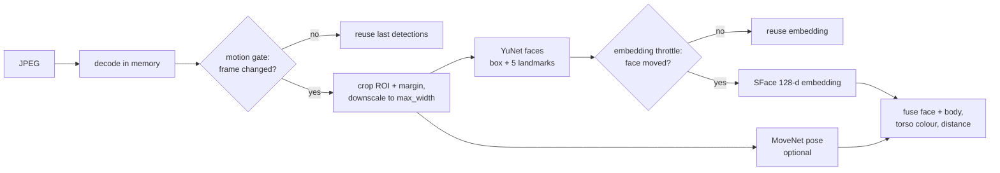

**English** · [繁體中文](zh-TW/detection.md)

# Detection (perception layer)

Perception turns a JPEG frame into a list of **detections**: a face box, a confidence, a 128-number face
fingerprint, and optionally a body skeleton, a clothing-colour histogram and a distance. Everything happens in
memory (`presence_demo/vision.py`, `body.py`, `appearance.py`, `optimizer.py`).



## 1. Saving work before detecting

Most frames in a conversation look like the previous one. Two cheap checks skip work:

- **Motion gate.** The frame is shrunk to 64×48 grey pixels and compared with the previous one. If the mean
  difference is below `motion_threshold` (0.015) and the state is stable, detection is skipped and the last result
  is reused. A full detection still runs at least every `force_detect_seconds` (2 s), and always in
  MAYBE_AWAY / AWAY so a returning person is never missed.
- **ROI crop.** Only the region of interest (plus `crop_margin`) is cropped and scaled down to at most `max_width`
  (640 px) pixels wide. Boxes are mapped back to full-frame coordinates afterwards.

## 2. Faces: YuNet

[YuNet](https://github.com/opencv/opencv_zoo) is a tiny face detector (a few hundred KB). It returns a box, a score and
five landmarks (eyes, nose, mouth corners). Detections below `min_conf` (0.4) are kept but marked *low
confidence*: they count neither as "someone" nor as "no one", which lets the higher layers fall back to audio.

The landmarks also give a **frontal score** between 0 and 1. It looks at how far the nose is from the midpoint
between the eyes, relative to the eye distance: nose centred → 1 (looking at the camera), offset of half the eye
distance or more → 0 (clear side view). Without landmarks (Haar fallback) the score is unknown and intent uses its
neutral default.

All three models (YuNet, SFace, MoveNet) run on ONNX Runtime; see [SDK and ONNX Runtime](sdk.md) for execution
providers and model files. OpenCV DNN, LiteRT and the Haar cascade remain as fallbacks.

## 3. Who is who: SFace embeddings

[SFace](https://github.com/opencv/opencv_zoo) turns an aligned 112×112 face into a 128-number vector. Two vectors
from the same person point in a similar direction, so the **cosine similarity** is high:

- ≥ `cos_match` (0.40): same person;
- below `cos_weak` (0.20): certainly different people;
- in between: only accepted together with good box overlap.

Embeddings are the most expensive step (about 10 ms per face on a laptop-class CPU), so they are **throttled**: a
face keeps its last embedding unless it is new, moved or changed size by more than `embed_move_thresh` (15%), or
`embed_interval` (3 s) has passed. Three backends compute the same model: `fp32` (default), `int8` and `npu`
(TFLite, can use an Android NPU). See [Performance](performance.md#embedding-backends-and-npu).

## 4. Bodies: MoveNet pose (optional)

With `pose_enabled`, [MoveNet MultiPose Lightning](https://www.kaggle.com/models/google/movenet) finds up to six
people and 17 keypoints each (about 6 ms). Bodies help in three ways:

- **People without a visible face** (turned away, too small) still count as present when the body confidence is
  above `body_min_conf`.
- **Orientation.** Shoulder width relative to the hips tells *facing*, *side* or *away*. Turning away while getting
  smaller (`recede_ratio`) for `turned_away_seconds` is an early "leaving" cue.
- **Body ROI.** A second, purple ROI for bodies; `roi_rule` decides whether a face, a body or either must be inside.

Faces and bodies are fused: a face is attached to the body whose head region (around the nose, eyes and ears) contains it.

## 5. Clothing colour (Kalman mode)

For the Kalman tracker each person also gets a **torso colour histogram**: hue × saturation, 12 × 4 bins, taken
from the shoulder–hip area (or below the face when there is no skeleton). Two histograms are compared with the
Bhattacharyya coefficient (1 = identical). It needs no model weights and helps tell two people apart when neither
face is visible.

## 6. Distance (optional)

With `distance_enabled`, distance comes from the pinhole camera model. An object of real width *W* that appears
*w* pixels wide in an image *I* pixels wide, with horizontal field of view *hfov*, is at

```
focal_px = (I / 2) / tan(hfov / 2)
distance = focal_px × W / w × distance_calib
```

*W* is 0.15 m for a face and 0.38 m for shoulders. The shoulder estimate is used only when the person faces the camera; the available estimates are averaged and then smoothed over time (`distance_ema`). Stand at a known distance and press *I am standing at this distance* (Distance calibration) to fix `distance_calib` for your camera. Distance feeds the
conversation zone (`zone_min`–`zone_max`), the "left" line `leave_distance`, the intent score and the audio
cross-check's pickup range.

Example: a 640 px frame, hfov 60°, a face 80 px wide → focal ≈ 554 px → distance ≈ 554 × 0.15 / 80 ≈ 1.04 m.

## Output

Each detection carries `bbox`, `conf`, `embedding`, `face_bbox`, `body` (box + keypoints), `appearance`,
`frontal` and, after the tracker, `distance`. The tracker never sees pixels.
