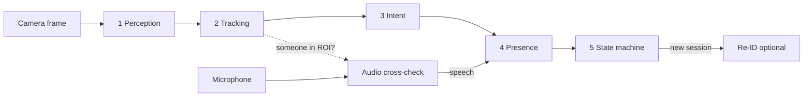

**English** · [繁體中文](zh-TW/how-it-works.md)

# How it works

A conversational device (a robot, a kiosk, a smart speaker with a camera) needs to know when the conversation is
over. "Nobody said anything for 20 seconds" is a poor answer: people pause, think, look at their phone, or stand
quietly while someone else talks. And a TV in the background "talks" all the time.

PresenceKit combines **what the camera sees** with **what the microphone hears** and keeps a small, explainable
state machine. Every decision comes with a written reason in the event log.

## The pipeline at a glance

| Step | In one sentence | Page |
|---|---|---|
| 1. Perception | Find faces and bodies in the frame, describe each face with a 128-number fingerprint, estimate distance. | [Detection](detection.md) |
| 2. Tracking | Connect today's detections with yesterday's people so everyone keeps the same id. | [Tracking](tracking.md) |
| 3. Intent | Decide who is a **participant** (wants to talk) and who is a **bystander**. | [Intent](intent.md) |
| 4. Presence | Turn noisy per-frame evidence into a stable "the group is still here" signal. | [Presence](presence.md) |
| 5. State machine | Map that signal (plus silence) to ACTIVE / IDLE / MAYBE_AWAY / AWAY / ENDED. | [State machine](state-machine.md) |
| Audio | Separate the near speaker's voice and let vision veto sounds that cannot be the user. | [Audio](audio.md) |
| Re-ID | When a new session starts, guess whether it is the previous user coming back. | [Re-ID](reid.md) |

Each layer has a simple mode and a smarter mode. You can switch them live in Settings and compare:

| Layer | Simple (default) | Smarter (in the *Recommended* preset) |
|---|---|---|
| Tracking | `legacy`: greedy match on face similarity + box overlap | `kalman`: motion prediction + global matching + clothing colour |
| Intent | `rules`: anyone in the ROI for `join_seconds` joins | `score`: a 0–1 engagement score from facing, distance, dwell… |
| Presence | `rules`: frame counters + silence timeouts | `hmm`: a per-person probability with hysteresis |
| Audio | `energy_vad`: browser loudness detector | `puresound`: server-side voice isolation + vision cross-check |

## A worked example

Alice walks up to the device, talks, gets blocked for a moment by someone walking past, then leaves.

1. **t = 0 s.** Alice enters the frame. YuNet finds her face; a new track `#1` is created. Her intent score starts
   low because she is still walking.
2. **t ≈ 2 s.** She stops, faces the camera, is about 1 m away. Her score passes the join threshold (0.6) for
   `join_seconds`, so she becomes a **participant**. The session starts: **ENDED → ACTIVE**.
3. **t = 3–8 s.** She talks. The audio pipeline hears speech, vision confirms that a person is within pickup
   range, so the speech counts. When she stops talking for 3 s the state becomes **IDLE** (still here, just quiet).
4. **t = 8–11 s.** Someone walks between Alice and the camera. Her face disappears for 3 s. With the Kalman
   tracker her track **coasts** on its predicted position; with the HMM her presence probability dips only a
   little. Nothing changes in the state machine.
5. **t = 18 s.** Alice leaves. No more detections. Her probability halves every `leave_halflife` (1.5 s) in odds.
   When it drops below 0.6 the state becomes **MAYBE_AWAY**, below 0.3 for a second **AWAY**.
6. **5 s later.** Still away: **ENDED**. All tracks and face fingerprints are erased from memory.

The figure below is produced by running the real tracker on exactly this kind of scene (1 frame per second). The
blue line is the group presence probability of the HMM model; the bands show the states of both presence models.

Notice the trade-off. The HMM ignores the 3 s occlusion completely (the probability never goes near a threshold),
but it is a few seconds slower to call AWAY after a real departure at 1 fps. A shorter `leave_halflife` makes it
quicker, at the cost of more false alarms during occlusions. The [Presence](presence.md) page shows how to choose.

## Why several layers?

Each layer removes one kind of error, so the next one has an easier job:

- **Tracking** stops "the same person" from turning into two people (or two people from swapping ids).
- **Intent** stops a bystander from keeping a finished conversation alive, and stops a passer-by from starting one.
- **Presence** stops a single missed detection or a dark frame from ending a conversation.
- **The state machine** turns all that into a few states with reasons a product can act on.
- **Audio cross-check** stops the TV or someone across the room from counting as the user speaking.

## What stays on the device

Frames are decoded in memory, processed and dropped. Nothing is written to disk. Face fingerprints live only in
memory and are cleared when a session ends. The two optional cloud features (speech recognition and re-ID) are
off by default and send data out only when you turn them on. Details: [Privacy](privacy.md).
