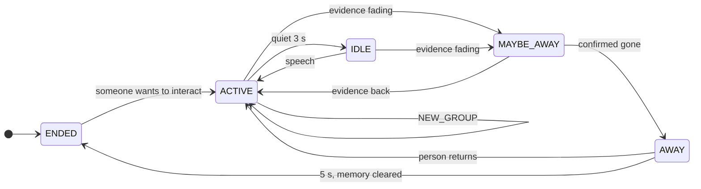

**English** · [繁體中文](zh-TW/state-machine.md)

# State machine

Everything the layers below compute ends up in one of five states. Each transition is written to the event log
with a reason, for example `ACTIVE → MAYBE_AWAY: P_group 0.58 < p_maybe 0.6`.

| State | Meaning | What a product might do |
|---|---|---|
| **ACTIVE** | Someone is engaged and spoke recently | Keep listening, respond |
| **IDLE** | Still here, quiet for `idle_after` (3 s) | Wait; maybe prompt gently |
| **MAYBE_AWAY** | Evidence is fading | Do not start a long answer; get ready to stop |
| **AWAY** | Confirmed gone | Stop talking, pause the dialogue |
| **ENDED** | Away for `end_after_away` (5 s); memory cleared | Close the conversation |

## Starting a session

From ENDED a session opens when:

- **intent `rules`**: a confident, not-far person is in the ROI (any `priority_mode`);
- **intent `score`**: someone's intent score reaches the join condition;
- **balanced / audio** mode: speech can also start a session;
- **PureSound audio with `onset_entry_only`** (default on): *only* a clean speech onset together with a visible,
  near person opens a session. A TV or a voice from far away cannot.

## Priority modes

`priority_mode` sets how much the microphone is trusted relative to the camera:

| Mode | Use it when | Behaviour |
|---|---|---|
| `vision` (default) | Noisy rooms, TVs, many voices | Audio only helps when vision is uncertain. A quiet person in view stays. |
| `balanced` | Quiet rooms, so-so camera | Both count; long silence ends a session even with people in view. |
| `audio` | No camera, or it is often blocked | Mostly speech-driven. |

`present_max_silence` (vision mode, 0 = off) caps how long a silent person in view keeps a session open, for
deployments where "standing there but ignoring the device" should end the conversation.

## Timeouts in rules mode

With `presence_model = rules`, the time to MAYBE_AWAY and AWAY depends on what vision currently sees:

| `priority_mode` | People visible | ROI empty | Vision uncertain |
|---|---|---|---|
| vision | never times out on silence (`present_max_silence` cap) | `empty_timeout` 5 s, audio ignored | `base_timeout` 20 s of silence |
| balanced | `present_timeout` 15 s of silence | `empty_timeout` 5 s, clock = min(silence, time empty) | `base_timeout` 20 s |
| audio | 1.5 × `base_timeout` | 0.5 × `base_timeout` | `base_timeout` |

- **MAYBE_AWAY** begins at `maybe_away_frac` (0.5) of the timeout, or earlier when every participant has been
  turned away and moving away for `turned_away_seconds` (2 s) without speaking.
- **AWAY** at the full timeout.

Example (vision mode, 1 fps): the user walks out at t = 0. After `absent_frames` (3) empty frames the ROI is
*empty* (t ≈ 3 s). MAYBE_AWAY at 2.5 s into the empty timeout, AWAY at 5 s, ENDED 5 s later: about 13 s in all.
With the Kalman tracker add about 1 s of coasting.

With `presence_model = hmm` the thresholds on `P_group` replace these timeouts; see [Presence](presence.md).

## Returning from AWAY

- **vision** mode: the person must be seen again; speech alone does not count.
- **balanced / audio**: new evidence counts: a speech onset, a person reappearing, or a new person.
- **vision** mode after `present_max_silence`: the person who stayed silent in view does not count as a return.
  Speech from someone in view, the person leaving and coming back, or a new person does. Otherwise the session
  ends after `end_after_away`, and that same silent person does not start a new one until they speak or leave
  the ROI first.
- With PureSound and `onset_needs_vision`, speech brings someone back only if vision sees a person (unless vision is
  uncertain).

## NEW_GROUP

Sometimes the group changes without the room ever being empty: the user leaves and the next visitor steps up.
NEW_GROUP handles this. It fires when

1. none of the current participants is present (rules: not visible; hmm: every participant's P < `p_away`), and
2. an unmatched newcomer has met the join condition (in ROI for `join_seconds`; with `score`, also intent ≥ join
   threshold), and
3. both have held for `new_group_seconds` (3 s).

The old session ends (its embeddings are erased) and a new session starts with the newcomers, so a downstream
dialogue system can start fresh. Coasting (predicted) tracks never count as newcomers.

## Ticks

Besides every processed frame, the state machine is re-evaluated every 0.5 s by a ticker, so timeouts fire on
time even when the browser sends few frames.
