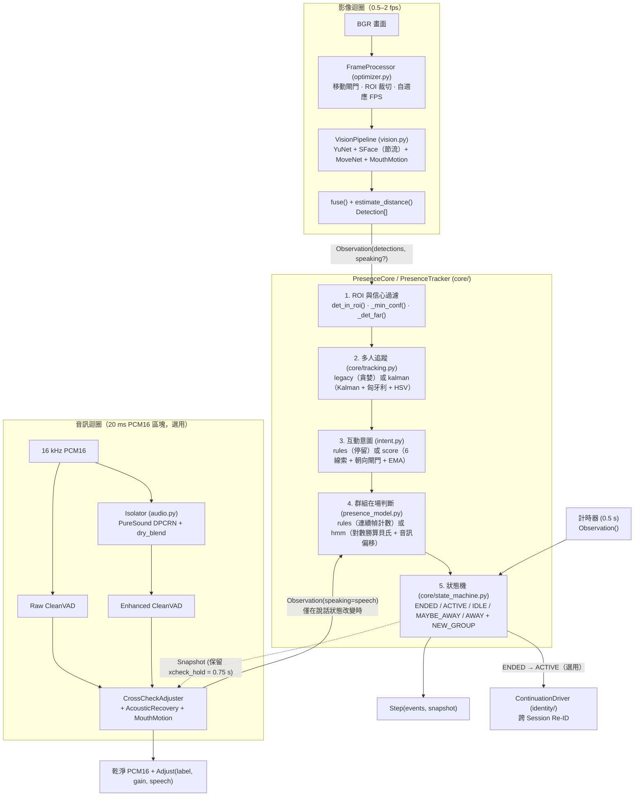
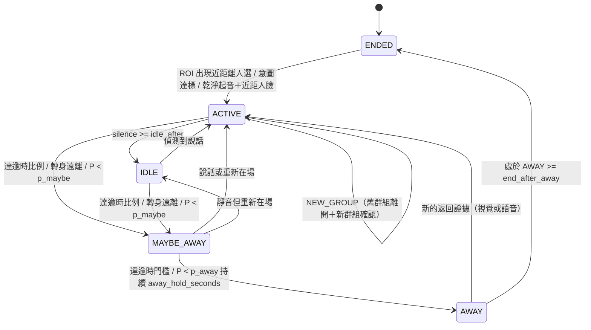

[English](../algorithms.md) · **繁體中文**

# 演算法詳細設計與組裝

本文件是 PresenceKit 演算法的技術入口，依據最新版程式碼完整定義各層的資料結構、數學模型與決策規則，並清楚說明**各演算法如何組裝成最終的在場狀態、事件與音訊輸出**。

若想先透過具體例子建立直覺，請看[運作原理](how-it-works.md)；各層的深入細節與評估圖表，請參考各節末的專屬頁面。

---

## 1. 端到端組裝總覽

PresenceKit 內部有兩條取樣率解耦的處理串流與一個週期性計時器，最後全部匯流到 `PresenceCore`（`presencekit/core/engine.py`）→ `PresenceTracker`（`presencekit/core/tracker.py`）：

### 呼叫端如何串接這幾條迴圈

- **嵌入式 SDK（`presencekit.sdk.PresenceEngine`）**：
  - `process_frame(image, speaking, now)` 執行 `FrameProcessor.process()` → `PresenceCore.update(Observation(dets, speaking), now)` → 回傳 `Step`。當 `process_audio()` 啟用時（`audio_pipeline == "puresound"`），傳入 `process_frame` 的 `speaking` 會被忽略，由乾淨音訊迴圈主導說話狀態。
  - `process_audio(pcm16, now)` 執行 `AudioStream.on_vision(snap, now)` → `AudioStream.process(...)` → 若 `speech != tracker.speaking`，呼叫 `PresenceCore.update(Observation(speaking=speech), now)`。
  - `tick(now)` 呼叫 `PresenceCore.update(Observation(), now)`，在沒有新影像或音訊輸入時推進靜音與離席計時器。
- **網頁執行期（`presencekit.runtime.session.PresenceRuntime`）**：
  - 使用完全相同的演算法管線，外加最新影格槽（覆蓋舊影格以避免延遲堆積）、有上限的音訊佇列（≤ 1 秒）與 0.5 秒計時器，將 `Step.snapshot` 與 `Step.events` 透過 WebSocket 送往瀏覽器。

---

## 2. 核心資料契約

定義於 `presencekit/core/tracks.py`、`presencekit/core/types.py`、`presencekit/body.py` 與 `presencekit/audio.py`：

| 型別 | 關鍵欄位 | 角色 |
|---|---|---|
| `Body` | `bbox`, `conf`, `keypoints` | 正規化身體框與 17 個 MoveNet 關鍵點 `(x, y, conf)` |
| `Detection` | `bbox`, `conf`, `embedding`, `face_bbox`, `body`, `frontal`, `appearance`, `mouth_motion` | 單一影格中一個人的融合偵測結果（臉框、選用身體、L2 正規化 128 維人臉向量、軀幹 HSV 直方圖、嘴部光流分數） |
| `Track` | `id`, `bbox`, `embedding`, `conf`, `first_seen`, `last_seen`, `in_roi_since`, `participant`, `visible`, `visible_kind`, `vis_conf`, `logodds`, `intent`, `intent_cues`, `body`, `distance`, `facing`, `facing_score`, `trend`, `far`, `appearance`, `mouth_motion`, `kf` | 跨影格持續追蹤的單人狀態 |
| `Observation` | `detections: list[Detection] \| None`, `speaking: bool \| None` | 傳入 `PresenceCore.update()` 的觀測事件 |
| `Step` | `events: tuple[PresenceEvent, ...]`, `snapshot: dict` | 每次核心更新的輸出：本次新產生的事件＋完整狀態快照 |
| `VisionView` | `usable`, `person`, `near`, `all_far`, `target`, `distance` | 供音訊交叉確認使用、保留 `xcheck_hold` 秒的視覺摘要 |
| `Adjust` | `mix`, `gain`, `speech`, `label`, `target_track`, `distance` | 每個音訊區塊的交叉確認決策（`agree`、`leak`、`false_accept`、`false_reject`、`silence`、`acoustic_only`） |

---

## 3. 各層演算法設計與規格

### 第 1 層：感知與省電最佳化（`optimizer.py`, `vision.py`, `body.py`, `mouth_motion.py`）

`FrameProcessor.process(image, cfg, stable, frame_time)` 將原始 BGR 畫面轉換為 `list[Detection]`：

1. **移動閘門（`motion_gate`）**：將畫面縮成 `64×48` 灰階縮圖。當 `stable` 為 `True`（狀態不是 `MAYBE_AWAY` 或 `AWAY`）、`mean(|thumb - prev_thumb|) / 255 < motion_threshold`（0.015），且距上次偵測小於 `force_detect_seconds`（2.0 秒）時，跳過偵測並沿用上一幀結果。
2. **ROI 裁切與縮放（`roi_crop`）**：取作用中 ROI（`face_roi`，若啟用姿態則包含 `pose_roi`）的聯集加上 `crop_margin`（0.1）進行裁切，縮放至寬度 ≤ `max_width`（640 px），偵測後再以 `map_raw_to_frame()` 映射回全圖座標。
3. **人臉偵測與節流 Embedding**：
   - **偵測器**：ONNX Runtime 上的 `YuNet`（`yunet_s_dynamic.onnx`），附 OpenCV DNN 與 Haar 備援。輸出臉框、信心度與 5 個關鍵點（雙眼、鼻尖、雙嘴角）。
   - **特徵提取（Embedder）**：ONNX Runtime 上的 `SFace`（`fp32` 或 `int8`）、LiteRT NPU 委派（`npu`），或 HSV 直方圖備援（`PRESENCE_FACE_EMBEDDER=hist`）。
   - **Embedding 節流（`embed_throttle`）**：若人臉框與快取相符（`moved() <= embed_move_thresh` 0.15）、自我相似度高且距上次計算小於 `embed_interval`（3.0 秒），則重複使用快取的 128 維向量。
4. **選用姿態、朝向與距離（`pose_enabled`, `distance_enabled`）**：
   - **姿態**：`MoveNet MultiPose Lightning`（ONNX Runtime 或 LiteRT 備援）；當所有追蹤人臉都穩定時，依 `pose_interval`（2.0 秒）節流。
   - **臉與身體配對（`fuse()`）**：`associate()` 透過貪婪配對將臉與頭部區域包含該臉中心的身體結合；沒有臉的身體則以 `head_box(body)` 作為追蹤框。
   - **朝向（`orientation(body)`）**：依鼻子（0.35）、雙眼（0.25）、鏡像肩序 `ls.x > rs.x`（0.20）與肩寬／軀幹高比例（最多 0.20）給出 `0..1` 分數，分為 `"facing"`（≥ 0.6）、`"side"`（≥ 0.3）或 `"away"`（< 0.3）。
   - **距離（`estimate_distance()`）**：以針孔幾何 `d = (real_width * f_px) / box_width_px * distance_calib` 計算（正規化焦距 `f_px = 0.5 / tan(hfov / 2)`）。正面優先用臉寬、否則用肩寬，經 `distance_ema`（0.3）平滑，並依 `recede_ratio`（0.1）追蹤約 2 秒內的距離趨勢 `trend`（`approaching` / `receding` / `steady`）。
5. **選用嘴部動作（`mouth_motion.py`）**：
   - 於 `xcheck_recovery_mode == "audiovisual"` 時啟用。在連續影格間隔 ≤ `FRESH_S = 0.085 s` 時，依雙眼關鍵點仿射對齊成 `128×128` 灰階圖塊，計算 Farneback 光流並扣除臉頰中位數位移（抑制頭部晃動），輸出正規化嘴唇相對於臉頰的 3 幀中位數動作量。

> 細節：[偵測](detection.md) · [效能](performance.md)

---

### 第 2 層：多人追蹤（`core/tracking.py`, `kalman.py`, `appearance.py`）

進入配對前，`PresenceTracker.update()` 先過濾偵測結果：

- **ROI 過濾（`det_in_roi`）**：依 `roi_rule`（`either`、`face`、`body`）檢查臉中心是否在 `face_roi` 內，或身體中心是否在 `pose_roi` 內。
- **信心分級**：`conf >= _min_conf(d)`（有人臉為 `min_conf` = 0.4；僅身體為 `body_min_conf` = 0.4）視為 `confident` 進入追蹤；其餘歸為 `low`（僅用來判斷視覺不確定）。
- **遠距過濾（`_det_far`）**：啟用距離時，超過 `leave_distance`（2.5 m）的偵測不能作為開啟新對話的 `starters`。

每幀先將既有軌跡設為 `visible=False, visible_kind="none", vis_conf=0.0`，再執行以下兩種配對策略之一：

- **`legacy`（貪婪配對）**：以 `cos_sim + 0.5 * IoU`（缺 embedding 時改用身體 IoU）為 `(偵測, 軌跡)` 計分，滿足 `cos_sim >= match_cos` 或（`IoU >= iou_match` 且 `cos_sim >= cos_weak`）者依分數由高到低貪婪配對。
- **`kalman`（Kalman + 匈牙利演算法 + 衣著外觀）**：
  1. 以等速 4D `KalmanBox` `(cx, cy, w, h, vx, vy, vw, vh)` 將所有軌跡預測至 `now`。
  2. 建立成本矩陣 `1 - score`，`score` 為可用線索的加權平均：
     - 預測框 `IoU`（權重 1.0）
     - 運動閘門分數 `exp(-d² / gate_mahalanobis)`（權重 1.0）
     - 經 `match_cos` 正規化的人臉餘弦相似度（權重 2.0）
     - 軀幹 HSV 直方圖 Bhattacharyya 相似度 `appearance_similarity`（權重 1.5）
  3. 排除未通過馬氏距離閘門（`d² > 9.21` 且無強人臉或 IoU）、人臉不同（`cos_sim < cos_weak`）、無人臉但衣著不同（`appearance_sim < appearance_min_sim`），或總分 `score < 0.3` 的配對。
  4. 以匈牙利演算法（`hungarian(cost)`）求解全域最佳指派。
  5. **滑行延續（Coasting）**：未配對但有 Kalman 濾波器且 `now - last_seen <= coast_seconds`（2.0 秒）的軌跡，維持 `visible=True, visible_kind="predicted"`，信心度線性衰減 `vis_conf = max(0, 1 - (now - last_seen) / coast_seconds)`。

配對成功後，以 EMA 更新人臉特徵（`embed_ema = 0.15`）與軀幹 HSV 直方圖（`appearance_ema = 0.2`）。超過 `grace_seconds`（15 秒）未出現的軌跡會被移除。

> 細節：[追蹤](tracking.md)

---

### 第 3 層：互動意圖（`intent.py`, `core/tracking.py`）

意圖層區分**參與者（participant）**與**路人／旁觀者（bystander）**：

- **`rules` 模式**：在 ROI 內且未超過遠距門檻的軌跡，只要連續停留 `now - in_roi_since >= join_seconds`（2.0 秒）即成為參與者；或當 `_speech_joinable()` 成立時立即加入（預設 `speech_join = "auto"` 時，在非純視覺模式或乾淨語音下採用 `single_candidate`：場上只有一位近距離正面人臉候選人且正在說話）。
- **`score` 模式**：由最多 7 個 `[0, 1]` 正規化線索計算原始分數：

| 線索 | 定義／來源 | 預設權重 |
|---|---|---|
| `facing` | `frontal_from_landmarks()`（鼻眼水平偏移）與 MoveNet `facing_score` 融合 | `w_facing = 0.45` |
| `still` | `max(0, 1 - \|vx\| / 0.12)` | `w_still = 0.15` |
| `center` | `face_roi` 內的 `1 - hypot(dx, 0.5 * dy)` | `w_center = 0.15` |
| `distance` | `d <= zone_max` 為 `1.0`，線性衰減至 `leave_distance` 為 `0.0` | `w_distance = 0.10` |
| `dwell` | `min(1.0, (now - in_roi_since) / 4.0)` | `w_dwell = 0.10` |
| `approach` | `clip(0.5 + 4.0 * rel_size_rate, 0, 1)` | `w_approach = 0.05` |
| `speech` | 正在說話且可合理歸因時為 `1.0` | `0.05 / 0.15 / 0.25`（依 `priority_mode`） |

缺少的線索（例如未開距離估計）會直接略過並重新正規化其餘權重（`raw_score()`），再通過**注意力閘門**避免背對裝置時靠停留累積高分：

$$\text{gated} = \text{raw} \times \bigl(1 - 0.5 \cdot (1 - \text{facing})\bigr)$$

最後依真實時間間隔 `dt` 與時間常數 `intent_tau`（1.0 秒）做指數平滑：

$$\text{intent}_t = \text{intent}_{t-1} + (\text{gated} - \text{intent}_{t-1}) \cdot \left(1 - e^{-dt / \tau}\right)$$

當 `intent >= join_threshold`（0.6）持續 `join_seconds` 即加入為參與者；當 `intent < drop_threshold`（0.35）持續 `drop_seconds`（8.0 秒）則退回旁觀者。

> 細節：[互動意圖](intent.md)

---

### 第 4 層：群組在場判斷（`presence_model.py`, `core/state_machine.py`）

將單人追蹤的可見性整合成穩定的群組在場訊號（`present`、`empty` 與 HMM 模式下的 `p_group`）：

- **`rules` 模式**：
  - `confident`（至少一位近距離、可見且實際偵測到的軌跡）累積 `_present_streak`；達 `present_frames`（2 幀）設為 `present = True, empty = False`。
  - `coasting`（Kalman 預測軌跡且 `vis_conf >= coast_present_conf`）會延後 `_first_empty_at` 並阻止進入 `empty = True`。
  - `low`（僅低信心偵測）累積 `_low_streak`；達 `absent_frames`（3 幀）設為 `present = False, empty = False`（進入不確定路徑，改用 `base_timeout`）。
  - 空畫面在無 coasting 時累積 `_empty_streak`；達 `absent_frames`（3 幀）設為 `present = False, empty = True`，並記錄 `empty_since`。
- **`hmm` 模式（連續時間對數勝算貝氏濾波器）**：
  - 每條軌跡維護 $L = \log\frac{P(\text{present})}{1 - P(\text{present})} \in [L_{\min}, L_{\max}]$（對應機率 $[0.02, 0.98]$），並以 `dt = min(now - prev_t, 3.0)` 積分：
    $$L \leftarrow \text{clip}\bigl(L + \text{rate} \cdot dt,\; L_{\min},\; L_{\max}\bigr)$$
  - `track_rate()` 依狀態決定速率（$\lambda = \ln 2 / \text{leave\_halflife}$）：
    - `far`（超過 `leave_distance`）：$-3\lambda$
    - `detected` 且 `turned_away`：$-\lambda$
    - `detected`（正常）：$+\text{detect\_gain} \cdot \text{conf}$
    - `predicted`（coasting）：$-\lambda \cdot (1 - \text{vis\_conf})$
    - `low_frame`：$-\lambda \cdot \text{lowconf\_factor}$
    - `none`（未見）：$-\lambda$
  - **群組彙總（`p_tracks`）**：取所有參與者的 `max(t.p)`（若尚無參與者，則取通過意圖門檻的候選人；若開啟 `intent_weighted_presence` 則乘上 `intent / join_threshold`）。當舊群組已低於 `p_away`，但場上有穩定成形的新候選人（`p >= p_active` 達 `join_seconds`）時，`p_tracks` 會納入該候選人，避免在 `NEW_GROUP` 交接前誤跳 `AWAY`。
  - **音訊融合（`p_group`）**：將全域音訊證據 $a$（`audio_offset`）加進對數勝算（永不單獨歸因給特定個人）：
    $$p_{\text{group}} = \sigma\bigl(\text{logit}(p_{\text{tracks}}) + a\bigr)$$
    說話時 $a = +w_{\text{speech}} \cdot 5.0$；靜音時 $a = -w_{\text{silence}} \cdot 6.0 \cdot \min(1, \text{silence} / \text{base\_timeout})$（`vision`：$w_{\text{speech}}=0.05, w_{\text{silence}}=0.0$；`balanced`：$0.8, 0.8$；`audio`：$1.0, 1.0$）。

> 細節：[在場判斷](presence.md)

---

### 第 5 層：對話狀態機與群組交接（`core/state_machine.py`）

五個核心狀態構成對話生命週期：

組裝關鍵規則：

- **起音門檻（`_entry_only`, `_onset_ok`）**：當 `audio_pipeline == "puresound"`（`speech_source == "clean"`）時：
  - 預設 `onset_entry_only = True`：**僅在乾淨語音起音且 1.5 秒內有近距離可見人選時**才會從 `ENDED` 開啟對話（`set_speech`）。純看鏡頭或純講話都不會開啟。
  - 若 `onset_entry_only = False`，`onset_needs_vision` 仍會要求近期有可見近距人選（除非視覺不確定），避免電視聲誤觸發。
- **優先權模式（`priority_mode`）**：
  - `vision`：有人在場就維持對話（除非設定 `present_max_silence > 0`）；ROI 確認清空則在 `empty_timeout`（5 秒）後離開，忽略音訊。僅視覺能從 `AWAY` 喚回（若因 `present_max_silence` 進入 `AWAY`，`_capped_return()` 會要求說話、新面孔或曾看過離席）。
  - `balanced`：在場用 `present_timeout`（15 秒）、清空用 `empty_timeout`（5 秒）、不確定用 `base_timeout`（20 秒）。
  - `audio`：依視覺調整 `base_timeout`（在場 `1.5×`、清空 `0.5×`、不確定 `1.0×`）。
- **提早轉身線索（`turned_away_early`）**：當所有可見且非遠距參與者皆呈現 `side`/`away` 且 `receding` 持續 `turned_away_seconds`（2.0 秒）且未說話時，提前進入 `MAYBE_AWAY`。
- **群組交接（`NEW_GROUP`）**：在非 `ENDED` 狀態下，若 `_old_group_missing()` 為真，且至少一位近距離、實際偵測到的非參與者滿足 `join_seconds`（HMM 模式下需 `p >= p_active`，score 模式下需 `_intent_ok`）持續 `new_group_seconds`（3.0 秒），系統立即結束舊對話並直接開啟新對話（不經過 `ENDED` 空窗），同時將該批新人升級為 `participant=True`。

> 細節：[狀態機](state-machine.md)

---

### 第 6 層：人聲分離、視覺交叉確認與起音救回（`audio.py`, `acoustic_recovery.py`）

當 `audio_pipeline == "puresound"` 時，每 20 ms 的 16 kHz PCM16 音訊區塊依序經過：

1. **人聲分離（`Isolator`）**：以 10 ms hop（512 點 STFT，30 ms 前瞻）執行 `dpcrn_curriculum_v2.onnx`，依 `iso_dry_blend`（預設 0.9，近場優先模式為 1.0）混合增強語音與對齊後的原始音訊。當發生 `NEW_GROUP`、session 切換或參與者集合改變且 `iso_reset_on_change` 開啟時，自動重置隔離器狀態。
2. **雙路 `CleanVAD`**：分別在**增強後訊號（`clean`）**與**原始訊號（`raw`）**上追蹤自適應底噪（下降即時、上升約 3 dB/s）。能量超過 `max(min_db, floor + margin_db)` 持續 60 ms 即判定說話，並有 `clean_vad_hang`（0.3 秒）延遲關閉。
3. **視覺時序對齊（`CrossCheckAdjuster.view`）**：以 `age = max(vis_age, max(0, capture_gap))` 判斷視覺新鮮度。若無快照、`age > xcheck_stale`（2.0 秒）或 `path == "uncertain"`，則視覺不可用（`usable=False`）。否則將 `person`、`near`（`<= near_range`）與 `all_far` 各保持 `xcheck_hold`（0.75 秒），且只要 `near` 仍在保持期間就壓制 `all_far`，保護近場講者的第一個音節。
4. **決策表（`CrossCheckAdjuster.decide`）**：
   - `usable == False` 或 `xcheck_enabled == False` → `acoustic_only`（直接輸出 PureSound 結果，`speech = clean`）。
   - `clean` 且 `not person` → `leak`（衰減至 `xcheck_floor_db` = −40 dB，`speech = False`）。
   - `clean` 且 `all_far` → `false_accept`（衰減至 `xcheck_floor_db`，`speech = False`）。
   - `clean` 且 `near` → `agree`（增益 1.0，`speech = True`）。
   - `not clean` 且 `raw` 且 `near` → `false_reject`，依 `xcheck_recovery_mode` 決定行為：
     - `legacy`：混合 `xcheck_recover_mix`（0.3）增強訊號＋ 0.7 延遲對齊原始訊號，`speech = True`。
     - `audio`：由 `AcousticRecovery` 檢查原始起音頻譜（能量上升 ≥ 8 dB 且高低頻斜率 ≤ −12 dB，維持 `HOLD_S = 0.12 s`），符合才放行起音救回（`speech = True`），否則壓制（`speech = False`）。
     - `audiovisual`：只要 `AcousticRecovery` 放行，**或**場上近距離可見軌跡具備新鮮嘴部動作（`mouth_motion >= MOUTH_THRESHOLD`）即放行救回。
   - 其餘情況 → `silence`（增益 1.0，`speech = False`）。

增益切換以 `xcheck_attack`（10 ms）與 `xcheck_release`（50 ms）平滑漸變，避免爆音。

> 細節：[音訊](audio.md)

---

### 第 7 層：跨 Session Re-ID（選用，`identity/`）

預設關閉（`reid_enabled = False`，需明確開啟 `reid_consent = True` 並提供 `TYPESAFE_API_KEY`）。

1. 當對話正常進入 `ENDED` 時，系統在記憶體中為每個連線／頁面保留最多 `reid_max_refs`（3）個已結束對話（每個對話最多 3 張代表人臉裁切，保存 `reid_ttl = 600 s`）。
2. 當新對話從 `ENDED → ACTIVE` 開啟時，`ContinuationDriver` 最多等待 `reid_face_wait`（3.0 秒）收集可用臉部裁切（寬度 `>= reid_min_face`），通過 `CallGuard`（冷卻時間、每小時／總次數上限、斷路器）後呼叫 `IdentityMatcher`（Jev 遠端服務）。
3. 相似度 `>= reid_threshold`（0.9）則接續先前對話（`resume`）；介於 `[reid_uncertain_low, reid_threshold)` 會重試一幀；低於門檻則建立新對話（`new`）。

> 細節：[Re-ID](reid.md)

---

## 4. 預設模式如何組裝各層（`settings.js`）

每個預設模式會同時設定多層演算法，確保它們彼此協作：

| 模式 | 追蹤 | 意圖 | 在場 | 音訊 | 姿態與距離 | FPS |
|---|---|---|---|---|---|---|
| **標準模式** | `legacy` | `rules` | `rules` | `energy_vad` | 關閉 | 自適應 0.5–2 |
| **近場優先** *（新瀏覽器預設）* | `kalman` | `score` | `hmm` | `puresound`（`iso_dry_blend=1.0`, `iso_onset_guard=false`, `xcheck_recovery_mode="audio"`, `near_range=1.3`） | 開啟 | 固定 2 |
| **省電模式** | `legacy` | `rules` | `rules` | `energy_vad` | 關閉（`max_width=480`, `embed_interval=5.0`） | 自適應 0.5–1 |
