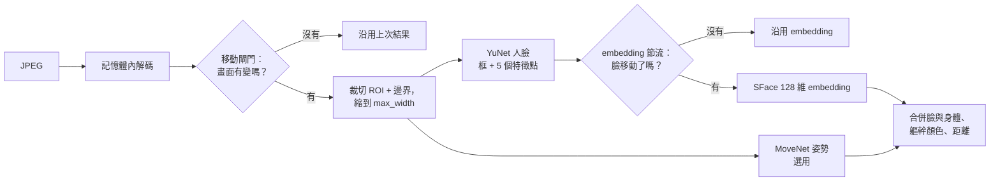

[English](../detection.md) · **繁體中文**

# 偵測（感知層）

感知層把一張 JPEG 畫面變成一串**偵測結果**：臉部框、信心值、128 個數字的臉部特徵（embedding），以及選用的身體骨架、
衣服顏色直方圖和距離。全部在記憶體中完成（`presence_demo/vision.py`、`body.py`、`appearance.py`、`optimizer.py`）。



## 1. 偵測前先省工

對話中大部分畫面都和上一張差不多。兩個便宜的檢查可以省下工作：

- **移動閘門。** 把畫面縮成 64×48 灰階，和上一張比較。平均差異低於 `motion_threshold`（0.015）而且狀態穩定時，
  跳過偵測、沿用上次結果。至少每 `force_detect_seconds`（2 s）仍會完整偵測一次；MAYBE_AWAY／AWAY 時一定完整偵測，
  不會漏掉回來的人。
- **ROI 裁切。** 只裁下 ROI（加上 `crop_margin`），縮到最寬 `max_width`（640 px）再偵測，框再換算回原畫面座標。

## 2. 人臉：YuNet

[YuNet](https://github.com/opencv/opencv_zoo) 是很小的人臉偵測器（幾百 KB），輸出框、分數和 5 個特徵點
（雙眼、鼻子、嘴角）。低於 `min_conf`（0.4）的偵測會保留，但標成**低信心**：既不算「有人」也不算「沒人」，
讓上層改用聲音判斷。

特徵點也可以算出 0–1 的**正面分數**：看鼻子離雙眼中點多遠（相對於眼距）。鼻子在正中間 → 1（看著鏡頭）；
偏移達眼距的一半以上 → 0（明顯側臉）。沒有特徵點時（Haar 備援）分數視為未知，意圖改用中性的預設值。

三個模型（YuNet、SFace、MoveNet）都跑在 ONNX Runtime 上；執行提供者和模型檔見 [SDK 與 ONNX Runtime](sdk.md)。
OpenCV DNN、LiteRT 和 Haar cascade 保留作為備援。

## 3. 誰是誰：SFace embedding

[SFace](https://github.com/opencv/opencv_zoo) 把對齊後的 112×112 人臉變成 128 個數字的向量。同一個人的兩個向量方向相近，
所以 **cosine 相似度**高：

- ≥ `cos_match`（0.40）：同一人；
- 低於 `cos_weak`（0.20）：一定是不同人；
- 介於兩者之間：要框的重疊也夠高才接受。

embedding 是最貴的步驟（一般筆電等級 CPU 每張臉約 10 ms），所以會**節流**：除非是新的臉、移動或大小變化超過
`embed_move_thresh`（15%），或超過 `embed_interval`（3 s），否則沿用上次的 embedding。同一個模型有三種計算方式：
`fp32`（預設）、`int8`、`npu`（TFLite，可用 Android NPU），見[效能](performance.md#embedding-後端與-npu)。

## 4. 身體：MoveNet 姿勢（選用）

開啟 `pose_enabled` 後，[MoveNet MultiPose Lightning](https://www.kaggle.com/models/google/movenet) 最多找出 6 個人、
每人 17 個關鍵點（約 6 ms）。身體有三個用途：

- **看不到臉的人**（轉身、太小）只要身體信心高於 `body_min_conf`，仍然算有人。
- **朝向。** 肩寬相對於髖部可以判斷*面向*、*側面*或*背對*。轉身並且變小（`recede_ratio`）持續 `turned_away_seconds`，
  是提早判斷「正在離開」的線索。
- **身體 ROI。** 第二個紫色 ROI；`roi_rule` 決定要臉、身體或任一個在框內。

臉和身體會合併：臉會配給頭部區域（鼻子、眼睛、耳朵附近）包含它的那個身體。

## 5. 衣服顏色（Kalman 模式）

Kalman 追蹤時，每個人還有一個**軀幹顏色直方圖**：色相 × 飽和度，12 × 4 格，取自肩膀到髖部的區域（沒有骨架時用臉下方）。
兩個直方圖用 Bhattacharyya 係數比較（1 = 完全相同）。不需要任何模型權重，在兩個人都看不到臉時可以幫忙分辨。

## 6. 距離（選用）

開啟 `distance_enabled` 後，用針孔相機模型估計距離。實際寬度 *W* 的物體，在寬 *I* 像素、水平視角 *hfov* 的畫面中
看起來寬 *w* 像素，距離是：

```
focal_px = (I / 2) / tan(hfov / 2)
distance = focal_px × W / w × distance_calib
```

臉的 *W* 是 0.15 m，肩膀是 0.38 m。肩膀只在人面向鏡頭時使用；可用的估計取平均後，再隨時間平滑（`distance_ema`）。
站在已知距離，按「距離校正」的「我站在這個距離」，就可以替你的鏡頭算出 `distance_calib`。距離會用在對話區
（`zone_min`–`zone_max`）、「離開」線 `leave_distance`、意圖分數，以及聲音交叉確認的收音範圍。

例子：畫面寬 640 px、hfov 60°、臉寬 80 px → focal ≈ 554 px → 距離 ≈ 554 × 0.15 / 80 ≈ 1.04 m。

## 輸出

每個偵測結果有 `bbox`、`conf`、`embedding`、`face_bbox`、`body`（框 + 關鍵點）、`appearance`、`frontal`，
追蹤器處理後再加上 `distance`。追蹤器從來不會看到像素。
