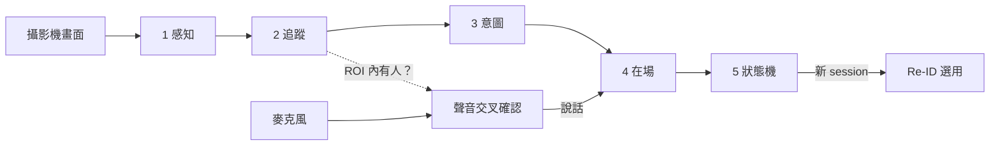

[English](../how-it-works.md) · **繁體中文**

# 運作原理

對話裝置（機器人、服務機台、有鏡頭的智慧音箱）需要知道對話什麼時候結束。「20 秒沒人說話」不是好答案：
人會停頓、思考、看手機，或是安靜站著聽別人說話；背景的電視卻一直在「說話」。

PresenceKit 結合**鏡頭看到的**和**麥克風聽到的**，維持一個小而可解釋的狀態機。每個決定都會在事件紀錄裡寫出原因。

## 整條管線

| 步驟 | 一句話說明 | 頁面 |
|---|---|---|
| 1. 感知 | 找出畫面中的臉和身體，把每張臉轉成 128 個數字的「指紋」，估計距離。 | [偵測](detection.md) |
| 2. 追蹤 | 把這一張的偵測結果和之前的人連起來，讓每個人保持同一個編號。 | [追蹤](tracking.md) |
| 3. 意圖 | 判斷誰是**參與者**（想說話），誰是**旁觀者**。 | [互動意圖](intent.md) |
| 4. 在場 | 把每張畫面雜亂的證據變成穩定的「這群人還在」訊號。 | [在場判斷](presence.md) |
| 5. 狀態機 | 把這個訊號（加上靜默）對應到 ACTIVE / IDLE / MAYBE_AWAY / AWAY / ENDED。 | [狀態機](state-machine.md) |
| 音訊 | 分離近距離說話者的聲音，再用影像否決不可能是使用者的聲音。 | [音訊](audio.md) |
| Re-ID | 新的 session 開始時，判斷是不是上一位使用者回來了。 | [Re-ID](reid.md) |

每一層都有簡單模式和進階模式，可以在設定裡即時切換比較：

| 層 | 簡單（預設） | 進階（「推薦」預設組合） |
|---|---|---|
| 追蹤 | `legacy`：用臉部相似度 + 框重疊逐一配對 | `kalman`：移動預測 + 整體最佳配對 + 衣服顏色 |
| 意圖 | `rules`：在 ROI 待滿 `join_seconds` 就加入 | `score`：用面向、距離、停留等算出 0–1 的意圖分數 |
| 在場 | `rules`：連續幀計數 + 靜默逾時 | `hmm`：每個人一個在場機率，加上遲滯 |
| 音訊 | `energy_vad`：瀏覽器音量偵測 | `puresound`：伺服器端人聲分離 + 影像交叉確認 |

## 完整例子

小美走到裝置前說話，中間被路過的人擋了一下，然後離開。

1. **t = 0 s。** 小美進入畫面。YuNet 找到她的臉，建立新的 track `#1`。她還在走，所以意圖分數一開始很低。
2. **t ≈ 2 s。** 她停下來、面向鏡頭、距離約 1 m。分數超過加入門檻（0.6）並持續 `join_seconds`，成為**參與者**。
   session 開始：**ENDED → ACTIVE**。
3. **t = 3–8 s。** 她在說話。音訊管線聽到說話，影像確認收音範圍內有人，所以算數。她停下 3 秒後狀態變成
   **IDLE**（人還在，只是安靜）。
4. **t = 8–11 s。** 有人從小美和鏡頭中間走過，她的臉消失 3 秒。Kalman 追蹤讓她的 track 沿著預測位置**延續**；
   HMM 的在場機率只稍微下降。狀態機沒有任何變化。
5. **t = 18 s。** 小美離開，不再有偵測結果。她的在場勝算每 `leave_halflife`（1.5 s）減半。
   機率低於 0.6 時變成 **MAYBE_AWAY**，低於 0.3 並持續 1 秒變成 **AWAY**。
6. **再過 5 秒。** 仍然不在：**ENDED**。所有 track 和臉部特徵都從記憶體中清除。

下圖是用真正的追蹤器跑這種情境（每秒 1 張）畫出來的。藍線是 HMM 模型的群組在場機率；下方色帶是兩種在場模型的狀態。

注意其中的取捨：HMM 完全不受 3 秒遮擋影響（機率離門檻很遠），但在 1 fps 下，真的離開時要多幾秒才判定 AWAY。
`leave_halflife` 調短會更快，但遮擋時比較容易誤判。怎麼選請見[在場判斷](presence.md)。

## 為什麼要分好幾層？

每一層去掉一種錯誤，讓下一層比較好做：

- **追蹤**：避免同一個人變成兩個人，或兩個人的編號互換。
- **意圖**：避免旁觀者讓已經結束的對話一直撐著，也避免路人開啟對話。
- **在場**：避免漏偵測一張、或一張畫面太暗就結束對話。
- **狀態機**：把這些整理成幾個狀態和原因，讓產品可以直接使用。
- **聲音交叉確認**：避免電視或房間另一頭的人被當成使用者在說話。

## 什麼留在裝置上

畫面只在記憶體中解碼、處理後就丟掉，不寫入磁碟。臉部特徵只存在記憶體，session 結束就清除。
兩個選用的雲端功能（語音辨識和 Re-ID）預設關閉，只有開啟時才會送出資料。詳見[隱私](privacy.md)。
