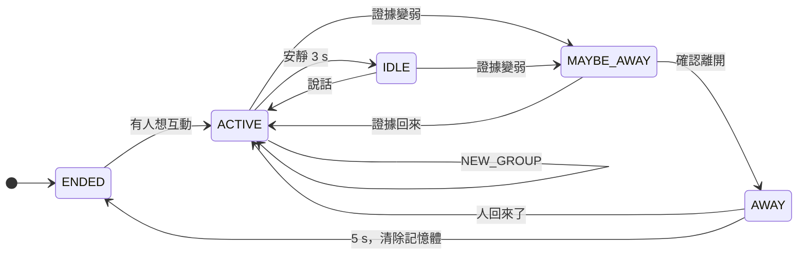

[English](../state-machine.md) · **繁體中文**

# 狀態機

下面各層算出來的結果，最後都會落在五個狀態之一。每次轉換都會連同原因寫進事件紀錄，例如
`ACTIVE → MAYBE_AWAY: P_group 0.58 < p_maybe 0.6`。

| 狀態 | 意思 | 產品可以怎麼做 |
|---|---|---|
| **ACTIVE** | 有人在互動，最近有說話 | 繼續聽、回應 |
| **IDLE** | 人還在，安靜達 `idle_after`（3 s） | 等待，或輕輕提示 |
| **MAYBE_AWAY** | 證據變弱 | 不要開始長篇回答，準備停止 |
| **AWAY** | 確認離開 | 停止說話，暫停對話 |
| **ENDED** | AWAY 持續 `end_after_away`（5 s），記憶體已清除 | 結束對話 |

## 開始 session

ENDED 時，以下情況會開始 session：

- **意圖 `rules`**：ROI 內有一位信心足夠、不會太遠的人（任何 `priority_mode`）；
- **意圖 `score`**：有人的意圖分數達到加入條件；
- **balanced / audio** 模式：說話也可以開始；
- **PureSound 音訊且 `onset_entry_only`**（預設開）：*只有*乾淨的說話開頭加上看得到的近距離的人才會開始。
  電視或遠處的人聲不會。

## 判斷優先模式

`priority_mode` 決定麥克風和鏡頭相比有多可信：

| 模式 | 適用 | 行為 |
|---|---|---|
| `vision`（預設） | 吵雜、有電視、很多人聲 | 聲音只在影像不確定時幫忙。安靜站在畫面裡的人會一直算在場。 |
| `balanced` | 安靜、鏡頭普通 | 兩者都算；即使看得到人，長時間靜默也會結束 session。 |
| `audio` | 沒有鏡頭，或常被擋住 | 主要看說話。 |

`present_max_silence`（vision 模式，0 = 關閉）限制安靜站在畫面裡的人最多能讓 session 維持多久，
適合「站在那裡但不理裝置」就該結束對話的場合。

## rules 模式的逾時

`presence_model = rules` 時，到 MAYBE_AWAY 和 AWAY 的時間取決於影像目前看到什麼：

| `priority_mode` | 看得到人 | ROI 空 | 影像不確定 |
|---|---|---|---|
| vision | 不因靜默逾時（`present_max_silence` 上限） | `empty_timeout` 5 s，不看聲音 | 靜默 `base_timeout` 20 s |
| balanced | 靜默 `present_timeout` 15 s | `empty_timeout` 5 s，計時 = min(靜默, 空的時間) | `base_timeout` 20 s |
| audio | 1.5 × `base_timeout` | 0.5 × `base_timeout` | `base_timeout` |

- **MAYBE_AWAY** 在逾時的 `maybe_away_frac`（0.5）開始；或者所有參與者都轉身並遠離 `turned_away_seconds`（2 s）
  而且沒說話時更早開始。
- **AWAY** 在逾時到時。

例子（vision 模式，1 fps）：使用者在 t = 0 走出畫面。連續 `absent_frames`（3）張空畫面後 ROI 變成*空*（t ≈ 3 s）。
空的逾時過 2.5 秒進入 MAYBE_AWAY，5 秒 AWAY，再 5 秒 ENDED：總共約 13 秒。用 Kalman 追蹤時再加上約 1 秒的延續。

`presence_model = hmm` 時，改用 `P_群組` 的門檻取代這些逾時，見[在場判斷](presence.md)。

## 從 AWAY 回來

- **vision** 模式：要再次看到人，只有說話不算。
- **balanced / audio**：新的證據就算數：說話開頭、人重新出現，或新的人。
- **vision** 模式因 `present_max_silence` 進入 AWAY 時：一直安靜待在畫面裡的人不算回來；畫面裡有人說話、那個人離開後
  再回來，或出現新的人才算。否則過了 `end_after_away` 後 session 結束，而且同一個安靜的人要先說話或離開 ROI，才會開始
  新的 session。
- 使用 PureSound 且開啟 `onset_needs_vision` 時，說話要搭配影像看到人才能讓人回來（影像不確定時例外）。

## NEW_GROUP

有時候人換了，房間卻從來沒空過：使用者離開，下一位訪客馬上走上前。NEW_GROUP 處理這種情況。觸發條件：

1. 目前的參與者都不在（rules：看不到；hmm：每位參與者的 P < `p_away`），而且
2. 有一位沒配對到的新來者達到加入條件（在 ROI 內 `join_seconds`；用 `score` 時還要意圖 ≥ 加入門檻），而且
3. 兩者都持續 `new_group_seconds`（3 s）。

舊的 session 結束（清除 embedding），用新來的人開新的 session，下游的對話系統就可以重新開始。延續中（預測）的 track
不算新來者。

## 定時檢查

除了每張處理過的畫面之外，ticker 每 0.5 秒也會重新評估狀態機，所以瀏覽器送的畫面很少時，逾時也會準時觸發。
